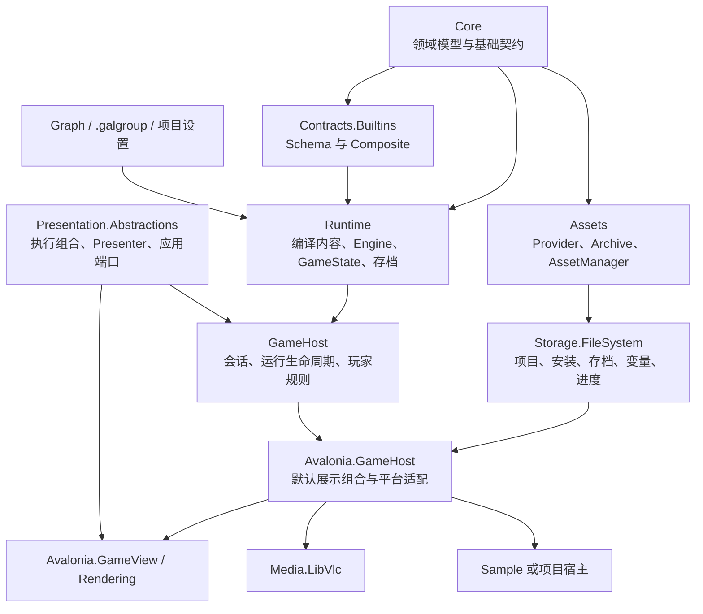

# 设计理念与架构概览

GalNet 将叙事运行、内容与资源、呈现和具体应用宿主分开。目标不是提供唯一的玩家界面，而是让同一份已编译内容可以由不同表现层与平台宿主可靠运行。

## 核心原则

- **内层不认识平台。** `Core`、`Runtime` 与内容契约不引用 Avalonia、WPF、WinUI、Skia、LibVLC 或文件路径。
- **内容和执行分离。** schema 与 composite 属于契约；primitive 模块、页面与媒体后端在宿主组合。完整 entry type ID 是唯一的注册键。
- **状态是可验证的事实。** 可持久化场景状态集中在注册式 `GameState`；任务、取消源、播放器身份和 UI 对象只在运行期存在。
- **资源通过租约取得。** 上层代码以 `IAssetManager` 获取资源，不扫描安装目录或假定实体文件路径。
- **组合根拥有策略和释放顺序。** Runtime 推进剧情，宿主负责应用会话、玩家偏好、平台资源和依赖注入；释放顺序始终从 Engine 到执行 view、presenter/后端及资源。

## 高层架构

这是依赖方向图，不是运行时创建顺序。具体程序集职责、生命周期和测试边界见[架构规范](spec/architecture.md)。

## 文档约定

`spec/` 只记录已经由代码和测试验证的事实；`manual/` 说明如何在既有边界内扩展。一次性 feature 的需求、设计取舍与验证历史保留在 `features/`，不作为当前 API 的权威来源。
