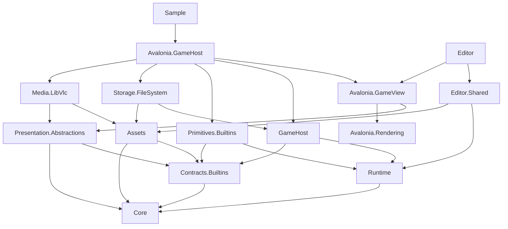

# GalNet 架构

## 分层

`Core` 不依赖 UI、文件系统或 DI。Runtime 的项目依赖只有 Core，不引用呈现抽象或默认执行模块；宿主组装文件系统、资源、媒体和页面实现。旧 `GalNet.Storage.Abstractions` 项目已删除。

```text
Core ───────────────────── 通用数据、执行/状态协议、通用资源 registry、服务契约
Diagnostics ────────────── 可选 Benchmark 构建的 CPU 事件与启动捕获，独立于领域层
Contracts.Builtins ──────── 内置场景/音频/Gallery/差分图片契约、默认资源、纯算法与 schema
Presentation.Abstractions ─ 执行注册/恢复组合、presenter 与平台无关应用契约
GameHost ───────────────── 游戏会话、内容聚合、运行生命周期、玩家持久化与偏好规则
Avalonia.GameHost ───────── 默认 Avalonia 会话、展示组合、设置 UI 和平台适配
Media.LibVlc ────────────── 可供不同 UI 框架复用的 LibVLC 音频后端
Runtime ────────────────── Graph、Compiled Group、Engine、存档状态与宿主端口
Assets ─────────────────── Local/PAK provider、Archive、AssetManager
Storage.FileSystem ─────── 项目/安装内容、保存、变量与进度实现
Avalonia.GameView ──────── 共享页面、导航、Gallery page registry、呈现
Editor.Shared ──────────── 项目读写、命令、导出
Editor / Samples ───────── 组合根与平台宿主
```

主要依赖方向如下（省略重复的 Core 引用）：



## 物理布局

`src` 按职责分组，项目名默认与程序集名一致；Sample.Contracts 为工具固定契约约定输出 GalNet.Project.Contracts：

```text
src/
  Shared/          Core、Contracts.Builtins、Runtime、Assets、Presentation.Abstractions、Primitives.Builtins、GameHost、Diagnostics
  Presentation/    Avalonia.Controls、Avalonia.Rendering、Avalonia.GameView、Avalonia.Themes、Avalonia.GameHost
  Infrastructure/  Storage.FileSystem、Media.LibVlc
  Editor/          Editor.Abstraction、Editor.Shared、Editor、Editor.Headless
  Samples/         Sample.Contracts、Sample.Avalonia、Sample.Headless
```

物理分组用于表达查找和所有权，不改变程序集名称、根命名空间或依赖方向。新增生产项目应放入与其职责一致的分组，并同步 `GalNet.slnx`；测试项目统一位于 `test/<Assembly>.Tests`。

程序集拥有自己的根命名空间：展示与执行注册端口位于 `GalNet.Presentation.Abstractions.*`，内置 schema、Entry DTO 与 Composite 位于 `GalNet.Contracts.Builtins`，primitive 和执行 module 位于 `GalNet.Primitives.Builtins`。契约项目只依赖 Core，执行模块按领域共享状态，可依赖 Runtime 的平台无关逻辑；Runtime 不反向依赖 Builtins。扩展程序集不得在 `GalNet.Core.*` 下声明类型；Core 只保留领域基础类型和扩展协议。注册的精确规则见[条目类型](entry-types.md)。

资源层只向上暴露 `IAssetProvider`、`IArchive`、`IGameFile` 和 `IAssetManager`。provider 定位源文件；manager 负责 GUID 查询、decoder 分派、缓存和 `AssetHandle<T>` 生命周期。Core、Runtime 与 Editor.Shared 不引用 Avalonia。

## 内容、资源与宿主组合

宿主在组合期建立并冻结一对 `IResourceTypeCatalog`、`IGalleryTypeCatalog`。同一实例必须传入开发/安装内容 provider、资源 provider、Preview 和 exporter；catalog 不是从内容文件反向创建的。这样资源 DTO、PAK、Gallery 编译和页面选择能对插件类型使用同一身份表。

```text
开发项目 ── ProjectGameContentProvider ── .meta -> GalleryCatalog
           LocalFileProvider(Assets/) ───── GUID -> raw bytes

安装目录 ── InstalledGameContentProvider ─ generated gallery.json + Graph/
           PakFileProvider(Assets/Paks/**/*.pak) ─ GUID -> PAK bytes
```

`.galpak` 只是 ZIP 运输容器。`GameInstallation` 验证并解压后，内容 provider 读取 Graph/settings/I18n/gallery 等特殊文件；只有 PAK 会成为资源 provider。详见 [资源](assets.md) 与 [文件格式](file-formats.md)。

## 游戏运行

可选 `GalNet.Debugging` 组件提供本机长度帧 JSON 连接、会话/内容身份校验、App 服务和借用的运行绑定。组件可以引用 Runtime，Runtime 不反向依赖通信。App 的调试连接与当前游戏运行独立，开始回调可省略；Editor/Sample 的默认交互接入仍按 feature 后续阶段推进。

`GameEngine` 持有 `IGameRuntime`，解释图、条目、Choice、skip batch 和快照；它不认识具体 UI。Engine 统一报告运行状态，负责停止、取消执行 scope 和等待内部 continuation 退出，不拥有执行 view 或平台后端。`IPrimitiveDispatcher` 解析 entry schema、创建 primitive instance 并调用 presenter 端口。影响场景的 primitive 先写入 `GameState`，再通知呈现端；读取快照后由宿主调用注册式 StateRestoreSession。

Avalonia 展示按领域拆为 dialogue/choice、layer、animation 和 particle presenter；`AvaloniaGamePresenters` 只创建并暴露这些 presenter，`CompositeGameView` 组合独立的 schema catalog 与执行模块，提供 Runtime 使用的 `IPrimitiveDispatcher`。`GameHost.GameSession` 串行化准备、开始、存档回调、运行替换与停止，拥有可替换的 `IGameRun`；默认 `GameRun` 组合 Engine 与展示恢复，不注册任何 Builtins，也不要求 Layer Presenter。`PlayerSession` 协调玩家持久化，`PlayerPreferences` 和 `PlayerStartup` 提供偏好与首次启动规则。文件实现通过 `GameResourceScope` 和 `FilePlayerSession` 组合。

`Avalonia.GameHost` 提供可直接使用的 `AvaloniaGameSession`、页面绑定 `AvaloniaGameRun`、展示组合 `AvaloniaGamePresentation`、纹理租约 `AvaloniaGameResources` 以及默认设置/窗口/手柄适配。`AvaloniaGameHostOptions` 由项目提供 catalog 和执行注册，预加载策略可替换；`AvaloniaGamePresentationOptions` 可替换 Layer 工厂与音频后端，新建适配对象的所有权交给展示会话。Sample 只保留启动参数、项目策略、本地化适配与调试扩展。

会话、显示能力和 Gallery 路径契约位于 `Presentation.Abstractions.Application`。共享 LibVLC 音频后端位于 `Media.LibVlc`，不引用 Avalonia；视频画面适配仍位于 Avalonia。释放顺序为运行/Engine → 展示恢复与执行 view → 平台后端 → Gallery 媒体与玩家持久化 → 纹理租约 → 内容资源。

Gallery catalog 是平台无关的静态内容。宿主把其自动生成的 `gallery_<item-id>_unlocked` Player bool 注册到变量服务；`GalleryDataSource` 合并 catalog 与当前 Player 值。Gallery 解锁不存于独立 UI 状态或存档槽。

Avalonia GameView 通过精确 Gallery `typeId` 的 `IGalleryPageRegistry` 选择页面。零个有内容类型时入口不可用，一个类型直达，多类型显示选择页；没有页面映射时进入诊断页，绝不按资源类型 fallback。Gallery 媒体的路径适配由宿主 resolver 完成，并且必须以 `AssetManager` acquire 的内容为来源。

## 编辑器工作流

`EditorProjectDocument` 是 UI 无关的图、Group、设置编辑聚合。资源 metadata 属于 `Assets/`；Gallery annotation 不进入 Editor document，也不存在集中式 Gallery authoring 文件。运行测试通过外部游戏调试构建正式内容并启动独立游戏进程；Editor 不再保留内嵌游戏 Engine、游戏呈现会话或运行变量副本。

GUI 的 `IEditorDocumentService`、变量定义服务和 `EditorDockFactory` 由项目 scope 持有。项目打开时加载作者 Graph/Group 一次；Group 以稳定 ID 和独立源路径登记为 `EditorGroupDocument`，项目级 `EditorGroupProjectionStore` 缓存可观察投影。Graph 节点、边、分支项直接引用作者 DTO，Group 页面以 ID 打开，页面关闭只释放订阅，不丢弃未保存内容。`EditorEntryData.Parameters` 保留原始 JSON 值；字符串仅用于控件和既有 CLI 输入适配。变量声明只保存在 Graph 的 playerVariables/saveVariables，settings 不再维护或派生变量副本。文档仓库仅接收项目路径，不消费设置模型或额外项目名称。

Editor 随发行包提供默认契约模板，新建项目不需要用户准备 DLL；留空自定义契约目录时，自动将默认契约复制到项目 `Contracts/`。新项目随后使用同一项目契约加载路径，自定义目录仅供需要自定义 schema 的项目选择。打开已有项目不会用该模板替换缺失或损坏的契约。

Editor 要求显式且唯一的 Entry 根节点，无效图不会被样例图替换或在加载时补节点。旧内嵌游戏预览已移除；旧布局中的游戏预览项作为不可用面板清理。

Editor 内容历史采用项目单栈，不随 Dock/Inspector 焦点切换；设置页首先接入显式草稿提交。GUI 的 `ProjectContentSession` 统一捕获并发布 Graph、Group 与完整设置，以实际内容与保存基线判断 dirty，后续编辑不被异步保存误标为已保存。关闭提供保存全部/放弃未保存内容/取消。作者文件事务的 manifest/备份与周期作者快照位于 `.galnet/editor/`，补偿失败禁止继续写入。Graph 基本操作由项目数据编辑记录承担，页面按文档事件同步投影；Group 创建/删除复用 Working/Saved 结构计划。分支/条目旧记录和完整 Group 草稿继续按后续阶段迁移，见 [Graph 基础编辑](editor-graph.md)；当前语义及边界见 [Editor 项目历史与保存](editor-history-and-save.md)。

CLI 只做参数、结果协议和退出码适配；Shared 提供原始查询、无写回校验、定向编译、严格编辑/保存、项目/Group 生命周期服务。原始访问保留未知内容，不依赖 entry DLL；有语义的操作使用项目 Contracts DLL，不回退内置。Editor 的 ProjectSchemaSession、catalog 及文档消费者由项目 scope 持有。不提供项目目录删除功能；最近项目列表仅支持移除记录。当前接口及范围见 [CLI README](../../src/Editor/GalNet.Editor.Headless/README.md)。

`EditorAssetManager`、`AssetCatalogService` 与 `GameExportService` 共享 Editor 组合根的 catalog。导出把资源写入基础 PAK，把 Graph/settings/I18n 和派生 Gallery JSON 写入 `.galpak`。

`EditorWorkspaceViewModel` 保留可观察 UI 状态、命令编排、history checkpoint 和自动保存触发。`GraphSelectionState` 维护节点/边选择与 `IsSelected` 一致性；`EditorWorkspacePersistence` 组合 repository、document service、mapper 与 project service 完成图的投影加载和保存。Graph 集合以只读可观察集合公开，只有作者操作可以改变文档成员；Group 作者操作返回稳定 Entry ID，由界面解析投影。字段工厂直接查询变量声明，不通过 Workspace。GUI 与 Headless 共用 `GraphEditRules` 的名称、坐标与连接规则，空分支没有出口。内置 Editor 命令由单一 handler 入口分派，Graph、Entry、Variable 和 Project 实现按领域分文件维护。

`Shell.EditorLayoutSession` 拥有布局恢复、命名布局和延迟持久化；`EditorMenuBuilder` 构建菜单，页面负责绑定与交互编排。`ProjectContentSession` 统一协调事务，草稿参与者由 `ProjectDraftRegistry` 管理，保存快照与内存内容比较由 `ProjectContentBaseline` 管理。比较不会为了读取 dirty 反复序列化或克隆整个项目，也不依赖历史游标或通知是否遗漏。

外部调试的 `ProjectDebugPreparation` 负责保存、构建与监听准备；`ProjectContentBuilder` 同时返回实际编译内容的 SourceMap 和作者指纹。`ExternalGameDebugClient` 管理连接和请求，`DebugApplicationProcess` 管理启动、退出和输出监控；断开后继续排空进程输出的行为保留。

Editor 扩展 registry 通过非泛型 `IDockPanelContribution` 和 `IInspectorControlContribution` 保存异构贡献，`object` 只存在于该类型擦除边界。新 contribution 应优先继承 `DockPanelContributionBase<TViewModel>`、`DockPanelContributionBase<TViewModel, TParameter>` 或 `InspectorControlContributionBase<TDockViewModel, TInspectorViewModel>`，由 bridge 集中校验 parameter、dock ViewModel 和 inspector ViewModel 类型；错误类型会在贡献边界报告预期与实际类型。`IServiceProvider` 继续表示全局或当前项目 scope，view 继续返回 `object` 以避免 Editor.Abstraction 引用 Avalonia。内置 panel 和 inspector contribution 均使用这些强类型入口。

## 测试边界

| 项目 | 职责 |
| --- | --- |
| `GalNet.Architecture.Tests` | 项目引用、命名空间与仓库结构门禁 |
| `GalNet.GameHost.Tests` | 通用运行会话、命令互斥、生命周期与偏好规则 |
| `GalNet.Core.Tests` | Core 领域模型与纯逻辑 |
| `GalNet.Runtime.Tests` | Runtime 状态、加载、表达式与存档序列化 |
| `GalNet.Primitives.Builtins.Tests` | 内置 entry module 与 primitive 行为 |
| `GalNet.Assets.Tests` | 资源 provider、压缩与加密 |
| `GalNet.Storage.FileSystem.Tests` | 文件系统存档、变量与进度实现 |
| `GalNet.Editor.Shared.Tests` | Editor 协议、命令、文档与持久化协作者 |
| `GalNet.Editor.Tests` | Editor UI、ViewModel 与交互逻辑 |
| `GalNet.Presentation.Tests` | 展示抽象、Avalonia 展示与渲染逻辑 |
| `GalNet.IntegrationTests` | 跨 Assets、Storage、Editor、Runtime 和 Sample 的端到端场景 |

Integration 测试只承载必须联合多个外层实现的场景；单一生产边界的测试留在对应项目，不通过引用其他测试项目共享实现。CI 分别执行纯逻辑与架构、Editor/Presentation 以及 Integration 三组测试。

## 维护规则

- 不让 Core、Runtime 或 Editor.Shared 反向引用具体 Avalonia 实现。
- `GalNet.Architecture.Tests/ProjectDependencyTests` 检查内层与共享项目、测试项目的直接依赖 allowlist，禁止测试项目互相引用，并要求 `GalNet.Storage.Abstractions` 项目及引用保持不存在；依赖边界变化必须同步更新本页和受影响模块规范。
- 内容、保存、玩家变量、变量桥接和进度协议由 Runtime 拥有；资源访问协议由 Core.Assets 拥有；Editor 设置和退出协议由 Editor.Abstraction 拥有。
- `ISaveService` 只提供异步、可取消的 I/O API，保存请求统一使用 `SaveRequest` 携带 snapshot 与可选展示 metadata。
- Provider 不管理解码对象或引用计数；页面/媒体实现不理解目录与 PAK 布局。
- 新资源类型、Gallery 类型、decoder 与页面各自注册在所属层；不要合并为一个跨层“资源模块”。
- 新持久化字段要同时检查作者 JSON、加载器、导出包、安装加载和验证测试。

变量桥接实现 `PlayerVariableService` 归 Runtime.Variables，仅通过 `IPlayerVariableStore` 持久化；文件实现为 `FilePlayerVariableStore`。变量值复制使用 Core 的 `Variable.Clone`，保留 Uid 并可显式替换名称；不可变 VariableValue 可共享。

Runtime 的 GraphLoader/GalgroupLoader/SaveManager 仅解析和序列化内容；文件路径和 I/O 由外层内容 provider、宿主和 ISaveService 实现处理。

Engine 的导航索引持有验证后的私有图副本，不共享作者集合或可变条目。外部变量读取返回独立值；执行模块共享的场景记录仍统一在 GameState.Read/Update 边界访问，不跨程序集暴露锁对象。

执行模块/呈现端借用 Core.Runtime.IGameContext；Engine 管理能力 IGameRuntime 与恢复候选 GameRestorePoint 属于 Runtime.Runtime。Core.Execution 拥有 IPrimitiveDispatcher、IChoicePresenter、ICatchUpPresentation 和 IPlayerPlaybackController，这些协议只包含中立执行数据；音频后端端口 IAudioPlaybackHost 与音频协议属于 Contracts.Builtins.Audio，音频执行、队列和票据属于 Primitives.Builtins.Audio。注册、分发及展示恢复组合仍位于 Presentation.Abstractions，具体 presenter 端口仍位于其 View。编辑器主题、Dock、快捷键、最近项目及嵌入布局 JSON 编码属于 Editor.Abstraction.Settings；Core 不持有这些宿主配置，未使用的 LauncherSettings 已删除。

展示执行抽象的 StateRestoreSession 拥有重放 continuation；宿主在执行 view 和平台 presenter 释放前异步释放该会话。Suspend 等待取消后仍保留旧实例，下一次重放或释放会继续等待真实展示清理。

Engine 只接收/更新 PlaybackOptions，音频接收不可变 AudioConfiguration 分组/轨道声明和 AudioMixOptions 的 master/group/track 混音值，不依赖完整玩家设置或运行上下文的设置容器。默认玩家偏好模型 GameSettings 位于 Avalonia.GameHost.Settings，通过组合根投影为模块输入；通用 PlayerSession 只持有玩家持久化与进度，不持有该偏好模型。清空玩家数据后由默认宿主重新绑定默认偏好。Editor 没有另设未使用的游戏偏好服务。Core.Configuration 只定义版本化 ProjectConfiguration/ConfigurationSection 协议；GameContent、GalProject 和作者文档使用 Configuration，不再绑定固定 ProjectSettings。默认项目 DTO DefaultProjectOptions 位于可选 Contracts.Builtins，默认模板/Sample 显式选择其 schema；Storage 通过 GameContentLoadOptions 接收 schema 和文化代码投影，运行模块仍接收小配置。通用 section 编辑和自有 DTO 的完整预览链路仍在 R4c 实施。

运行与宿主资源的依赖及生命周期以本页的游戏运行段和[运行时规范](runtime.md)为准，包括 GameView 对 Assets 的媒体 adapter 默认实现依赖。

场景/音频领域类型及纯算法位于可选 Contracts.Builtins.Scene/Audio。IGameContext 和 GameRuntime 不提供 SceneInstances；内置视觉模块通过 runtime.Scene() 访问按 GameState 根隔离的场景服务，临时动画控制不进入快照。StateCatalog 的可选 keySpace 提供跨表唯一性和查询，Core 只处理通用身份，不认识 ISceneInstance；内置视觉状态显式选择 builtin.scene。Runtime 仅引用 Core，最小自定义 primitive 不需要场景或音频模块。

GameContent、GameContentLoadOptions 和 GameLocalizationContent 属于 GameHost.Content；GalleryDataSource 属于 GameHost.Gallery。它们是宿主选择的默认内容/玩家组合，Engine 不依赖这些聚合。Core.Assets 只保留通用 metadata、资源类型目录、查询与租约协议；默认 DTO/工厂和 Gallery/ImageVariants 数据属于 Contracts.Builtins。资源目录的默认类型由组合根显式选择，provider 和 PAK 接收该目录，不自行创建 Builtins。没有专属字段的默认资源复用 AssetMeta，sprite 另有 filter DTO。
