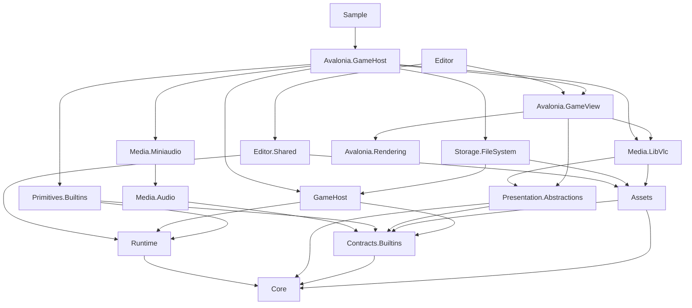

# GalNet 架构


## 分层

`Core` 不依赖 UI、文件系统或 DI。Runtime 的项目依赖只有 Core，不引用呈现抽象或默认执行模块；宿主组装文件系统、资源、媒体和页面实现。旧 `GalNet.Storage.Abstractions` 项目已删除。

```text
Core ───────────────────── 通用数据、执行/状态协议、通用资源 registry、服务契约
Diagnostics ────────────── 可选 Benchmark 构建的 CPU 事件与启动捕获，独立于领域层
Contracts.Builtins ──────── 内置场景/音频/Gallery/差分图片契约、默认资源、纯算法与 schema
Presentation.Abstractions ─ 执行注册/恢复组合、presenter 与平台无关应用契约
GameHost ───────────────── 游戏会话、内容聚合、运行生命周期、玩家持久化与偏好规则
Avalonia.GameHost ───────── 默认 Avalonia 会话、展示组合、设置 UI 和平台适配
Media.Audio ─────────────── 跨平台 PCM 混音与 DSP
Media.Miniaudio ──────────── 原生设备与流式解码适配（当前实机验证 Windows x64）
Media.LibVlc ────────────── 视频/Gallery/Editor 共用的原生初始化、配置与独立媒体会话工厂
Runtime ────────────────── Graph、Compiled Group、Engine、存档状态与宿主端口
Assets ─────────────────── Local/PAK provider、Archive、AssetManager
Storage.FileSystem ─────── 项目/安装内容、保存、变量与进度实现
Avalonia.GameView ──────── 共享页面、导航、Gallery page registry、呈现
Editor.Shared ──────────── 项目读写、命令、导出
Editor / Samples ───────── 组合根与平台宿主
```

主要依赖方向如下（省略重复的 Core 引用）：



## 物理布局

`src` 按职责分组，项目名默认与程序集名一致；Sample.Contracts 为工具固定契约约定输出 GalNet.Project.Contracts：

```text
src/
  Shared/          Core、Contracts.Builtins、Runtime、Assets、Presentation.Abstractions、Primitives.Builtins、GameHost、Diagnostics
  Presentation/    Avalonia.Controls、Avalonia.Rendering、Avalonia.GameView、Avalonia.Themes、Avalonia.GameHost
  Infrastructure/  Storage.FileSystem、Media.Audio、Media.Miniaudio、Media.LibVlc、Input.Sdl3
  Editor/          Editor.Abstraction、Editor.Shared、Editor、Editor.Headless
  Samples/         Sample.Contracts、Sample.Player、Sample.Avalonia、Sample.Headless、Sample.CrossPlatform
```

物理分组用于表达查找和所有权，不改变程序集名称、根命名空间或依赖方向。新增生产项目应放入与其职责一致的分组，并同步 `GalNet.slnx`；测试项目统一位于 `test/<Assembly>.Tests`。

程序集拥有自己的根命名空间：展示与执行注册端口位于 `GalNet.Presentation.Abstractions.*`，内置 schema、Entry DTO 与 Composite 位于 `GalNet.Contracts.Builtins`，primitive 和执行 module 位于 `GalNet.Primitives.Builtins`。契约项目只依赖 Core，执行模块按领域共享状态，可依赖 Runtime 的平台无关逻辑；Runtime 不反向依赖 Builtins。扩展程序集不得在 `GalNet.Core.*` 下声明类型；Core 只保留领域基础类型和扩展协议。注册的精确规则见[条目类型](../runtime/entries.md)。

资源层只向上暴露 `IAssetProvider`、`IArchive`、`IGameFile` 和 `IAssetManager`。provider 定位源文件；manager 负责 GUID 查询、decoder 分派、缓存和 `AssetHandle<T>` 生命周期。Core、Runtime 与 Editor.Shared 不引用 Avalonia。

## 测试边界

| 项目 | 职责 |
| --- | --- |
| `GalNet.Architecture.Tests` | 项目引用、命名空间与仓库结构门禁 |
| `GalNet.GameHost.Tests` | 通用运行会话、命令互斥、生命周期与偏好规则 |
| `GalNet.Core.Tests` | Core 领域模型与纯逻辑 |
| `GalNet.Runtime.Tests` | Runtime 状态、加载、表达式与存档序列化 |
| `GalNet.Primitives.Builtins.Tests` | 内置 entry module 与 primitive 行为 |
| `GalNet.Assets.Tests` | 资源 provider、压缩与加密 |
| `GalNet.Storage.FileSystem.Tests` | 文件系统存档、变量与进度实现 |
| `GalNet.Editor.Shared.Tests` | Editor 协议、命令、文档与持久化协作者 |
| `GalNet.Editor.Tests` | Editor UI、ViewModel 与交互逻辑 |
| `GalNet.Presentation.Tests` | 展示抽象、Avalonia 展示与渲染逻辑 |
| `GalNet.IntegrationTests` | 跨 Assets、Storage、Editor、Runtime 和 Sample 的端到端场景 |

Integration 测试只承载必须联合多个外层实现的场景；单一生产边界的测试留在对应项目，不通过引用其他测试项目共享实现。CI 分别执行纯逻辑与架构、Editor/Presentation 以及 Integration 三组测试。

## 维护规则

- 不让 Core、Runtime 或 Editor.Shared 反向引用具体 Avalonia 实现。
- `GalNet.Architecture.Tests/ProjectDependencyTests` 检查内层与共享项目、测试项目的直接依赖 allowlist，禁止测试项目互相引用，并要求 `GalNet.Storage.Abstractions` 项目及引用保持不存在；依赖边界变化必须同步更新本页和受影响模块规范。
- 内容、保存、玩家变量、变量桥接和进度协议由 Runtime 拥有；资源访问协议由 Core.Assets 拥有；Editor 设置和退出协议由 Editor.Abstraction 拥有。
- `ISaveService` 只提供异步、可取消的 I/O API，保存请求统一使用 `SaveRequest` 携带 snapshot 与可选展示 metadata。
- Provider 不管理解码对象或引用计数；页面/媒体实现不理解目录与 PAK 布局。
- 新资源类型、Gallery 类型、decoder 与页面各自注册在所属层；不要合并为一个跨层“资源模块”。
- 新持久化字段要同时检查作者 JSON、加载器、导出包、安装加载和验证测试。

变量桥接实现 `PlayerVariableService` 归 Runtime.Variables，仅通过 `IPlayerVariableStore` 持久化；文件实现为 `FilePlayerVariableStore`。变量值复制使用 Core 的 `Variable.Clone`，保留 Uid 并可显式替换名称；不可变 VariableValue 可共享。

Runtime 的 GraphLoader/GalgroupLoader/SaveManager 仅解析和序列化内容；文件路径和 I/O 由外层内容 provider、宿主和 ISaveService 实现处理。

Engine 的导航索引持有验证后的私有图副本，不共享作者集合或可变条目。外部变量读取返回独立值；执行模块共享的场景记录仍统一在 GameState.Read/Update 边界访问，不跨程序集暴露锁对象。

执行模块/呈现端借用 Core.Runtime.IGameContext；Engine 管理能力 IGameRuntime 与恢复候选 GameRestorePoint 属于 Runtime.Runtime。Core.Execution 拥有 IPrimitiveDispatcher、IChoicePresenter、ICatchUpPresentation 和 IPlayerPlaybackController，这些协议只包含中立执行数据；音频后端端口 IAudioPlaybackHost 与音频协议属于 Contracts.Builtins.Audio，音频执行、队列和票据属于 Primitives.Builtins.Audio。注册、分发及展示恢复组合仍位于 Presentation.Abstractions，具体 presenter 端口仍位于其 View。编辑器主题、Dock、快捷键、最近项目及嵌入布局 JSON 编码属于 Editor.Abstraction.Settings；Core 不持有这些宿主配置，未使用的 LauncherSettings 已删除。

展示执行抽象的 StateRestoreSession 拥有重放 continuation；宿主在执行 view 和平台 presenter 释放前异步释放该会话。Suspend 等待取消后仍保留旧实例，下一次重放或释放会继续等待真实展示清理。

Engine 只接收/更新 PlaybackOptions，音频接收不可变 AudioConfiguration Bus/Track 声明和 AudioMixOptions 的 master/bus/track 混音值，不依赖完整玩家设置或运行上下文的设置容器。默认玩家偏好模型 GameSettings 位于 Avalonia.GameHost.Settings，通过组合根投影为模块输入；通用 PlayerSession 只持有玩家持久化与进度，不持有该偏好模型。清空玩家数据后由默认宿主重新绑定默认偏好。Editor 没有另设未使用的游戏偏好服务。Core.Configuration 只定义版本化 ProjectConfiguration/ConfigurationSection 协议；GameContent、GalProject 和作者文档使用 Configuration，不再绑定固定 ProjectSettings。默认项目 DTO DefaultProjectOptions 位于可选 Contracts.Builtins，默认模板/Sample 显式选择其 schema；Storage 通过 GameContentLoadOptions 接收 schema 和文化代码投影，运行模块仍接收小配置。Editor 按项目 schema 生成通用 section 表单，批量提交、Undo/Redo、保存、导出和安装加载保留未知配置；默认语言声明由 I18n 面板编辑。宿主通过 SelectProjectOptions 显式投影，自有 DTO 控制模块输入；调试使用外部游戏宿主。

运行与宿主资源的依赖及生命周期以本页的游戏运行段和[运行时规范](../runtime/execution.md)为准，包括 GameView 对 Assets 的媒体 adapter 默认实现依赖。

场景/音频领域类型及纯算法位于可选 Contracts.Builtins.Scene/Audio。IGameContext 和 GameRuntime 不提供 SceneInstances；内置视觉模块通过 runtime.Scene() 访问按 GameState 根隔离的场景服务，临时动画控制不进入快照。StateCatalog 的可选 keySpace 提供跨表唯一性和查询，Core 只处理通用身份，不认识 ISceneInstance；内置视觉状态显式选择 builtin.scene。Runtime 仅引用 Core，最小自定义 primitive 不需要场景或音频模块。

GameContent、GameContentLoadOptions 和 GameLocalizationContent 属于 GameHost.Content；GalleryDataSource 属于 GameHost.Gallery。它们是宿主选择的默认内容/玩家组合，Engine 不依赖这些聚合。Core.Assets 只保留通用 metadata、资源类型目录、查询与租约协议；默认 DTO/工厂和 Gallery/ImageVariants 数据属于 Contracts.Builtins。资源目录的默认类型由组合根显式选择，provider 和 PAK 接收该目录，不自行创建 Builtins。没有专属字段的默认资源复用 AssetMeta，sprite 另有 filter DTO。
