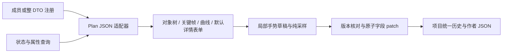

# 复杂参数定制与对象树时间轴

日期：2026-10-18。状态：design，尚未实现。归属 F-20261015-02 / P6 后续，扩展 [参数控件与场景目标设计](parameter-editor-design.md) 第 5–8 节；三层注册与状态查询的总体职责仍以该文为准。

## 1. 用户要求与本轮选择

用户要求复杂定制参考 Unity 类动画编辑交互：时间轴左侧树形结构以场景对象为父节点、对象支持的属性为子节点；可以选择属性加入动画控制，节点能够编辑值和切线，并展开为值曲线。此处按用户描述设计交互，不承诺复制 Unity 全部功能。

“作为轴重载”按属性加入当前动画的控制范围理解：未加入时不生成轨道；加入后由轨道控制该属性。它与运行时 Replace/Additive 混合方式分开。后者是轨道设置，不是第二套同属性覆盖轨道；当前运行时要求同一目标和属性在一个 Plan 内唯一。

首版目标是完成对象/属性轨道、关键帧、Hermite 曲线、事件、纯数值预览与项目历史。完整游戏场景预览、录制游戏对象操作、嵌套动画片段、音视频剪辑、多层动画混合不在本轮范围。颜色、变换、粒子与 effect 参数按同一扩展机制接入，但不要求第一批同时交付全部专业编辑器。

## 2. 已核对的代码事实

| 事实 | 设计影响 |
| --- | --- |
| P6a/P6b 已有 RegisterDto/RegisterMember/RegisterDefault、DtoEditorHost、SchemaForm、lease 与复杂值 JSON 回退 | 继续在三层映射上组合，不增加另一套编辑器注册体系 |
| AnimationPlanOptions.Plan 是 JsonElement，BatchId 是另一个字段 | 对 Plan 注册成员覆盖即可；BatchId 继续自动表单 |
| Core 的 AnimationPlanDefinition 已有 FrameRate、DurationFrames、Tracks、Events、LoopMode、Blocking、Skippable | 时间轴编辑现有计划，不另造编译时动画语言 |
| AnimationTrackDefinition 是 HandleId + Property + BlendMode + Keys | 对象父行由轨道分组投影产生，默认不增加运行时对象树 |
| Key.Frame 是整数，Value/InTangent/OutTangent 是 float，插值为 Step/Linear/CubicHermite，插值属于当前键之后的区间 | 编辑数据按帧保存；不能把任意加权 Bezier 或无限斜率直接塞进现有格式 |
| AnimationTrackSampler.Evaluate 是现有纯采样器 | 曲线显示和数值预览复用它，避免两套插值结果 |
| 完整校验要求首键在 0 帧、键严格递增、不得超过时长、同目标属性轨道唯一、浮点数有限、FPS 为 1..240 | 明确处理首键移动、碰撞、时长缩短和切线输入 |
| 内置 Plan 事件只接受图层显示/隐藏/移动/替换、effect 应用/停止、粒子启动/停止/burst 等限定类型 | 事件选择器使用明确能力清单，不能展示任意 catalog Entry |
| Plan 事件有同帧原数组顺序；运行时在采样前通知相应事件 | 事件排序与定位必须保留原序，同帧对象创建和动画采样要一致 |
| Editor 只有字段/DTO patch 提交与部分 Preview binding，没有通用拖动事务或作者场景查询 | 这两部分是待实现依赖，不能把现有接口改名当作完成 |

主要证据：[Plan/采样器](../../src/Shared/GalNet.Core/Scene/AnimationPlan.cs)、[契约 DTO](../../src/Shared/GalNet.Contracts.Builtins/Entry/ComplexPrimitiveOptions.cs)、[完整校验](../../src/Shared/GalNet.Contracts.Builtins/BuiltinArgumentValidation.cs)、[事件调度](../../src/Shared/GalNet.Primitives.Builtins/AnimationPlanPrimitiveInstance.cs)、[当前表单协议](../../src/Presentation/GalNet.Avalonia.Controls/Forms/FieldBinding.cs)。这是静态代码核对，不是新增功能验证。

## 3. 界面与树形轨道

Plan 字段内提供紧凑摘要和“编辑时间轴”入口；展开或在工作区面板中编辑时，两者使用同一个编辑会话，不能同时创建两个独立可写草稿。详情区继续复用 DTO 表单。

```text
播放/暂停  上一键 下一键  当前帧/秒  FPS  时长  吸附  [关键帧 | 曲线]
对象与属性树                         时间刻度 / 播放头
▾ 左侧角色                           ◇        ◇        ← 汇总
  ▾ 位置                             （仅分组）
    ☑ X                              ◆────────◆        ← 属性轨道
    ☑ Y                              ◆────◆───◆
  ☑ 不透明度                         ◆────────◆
▾ 背景
  ☑ 不透明度                         ◆────◆
▾ 事件                               ▣    ▣            ← 独立事件行
选中关键帧 / 轨道 / 事件的详情（默认表单 + 必要专属控件）
```

对象行展示友好名称、类型/缩略图、一定存在或可能存在；不显示 handle。同名对象加来源 Group/创建条目说明。位置/旋转等中间节点只是显示分组，只有运行时实际声明可动画的叶属性可加入轨道，不能凭 DTO 的所有数值字段推测动画能力。

添加对象后，从支持属性中搜索/勾选要加入的属性；可以切换“显示可添加属性”，默认树主要展示已加入的轨道。属性勾选代表已创作轨道，取消勾选是明确移除轨道的一条可撤销操作；单纯隐藏曲线、折叠或筛选不删除数据。空父对象可保留为本地视图状态，保存不写入空运行时对象组。

一个属性只能有一条轨道。Replace/Additive 使用现有 BlendMode，界面显示“绝对值/叠加偏移”等可理解文案。没有运行时 mute/solo 字段，首版的曲线显示开关只影响视图，不能暗示关闭了游戏播放。

对象/分组父行的菱形是子轨道同帧键的汇总；点击可选择这些键。首版拖动在叶行完成，父行汇总只用于定位与选择，避免折叠时无意批量修改。左树和右侧时间区域共用行布局、纵向滚动及折叠状态；横向缩放/滚动只影响时间区域。

多对象选择和曲线可见性属于视图状态，不进内容历史。键盘操作遵守输入控件焦点：Space 仅在时间轴画布播放/暂停，文本和 NumericUpDown 保留自己的输入；Delete 删除所选键/事件，Ctrl+Z/Redo 路由到项目历史，不能单独维护时间轴历史。

## 4. 关键帧与值曲线

关键帧模式以菱形编辑帧位置，曲线模式以值对帧绘图；两者使用同一轨道和选择集合。曲线模式可以显示多条选中属性曲线，各有颜色、图例和可见开关；默认按属性单独缩放 Y，允许显式叠加并提示单位不同。鼠标悬浮/播放头显示当前帧及采样值。

选中键后详情显示帧、秒、值、出段插值、入/出切线。数字用 NumericUpDown，bool 用 CheckBox；枚举选择器支持搜索。画布拖动和数值输入相互同步，批量选择中不相同的字段显示混合值，修改后对选中集合原子应用。

规则：

- 添加轨道必须显式创建首键 0；Replace 在静态查询能给出唯一值时提供该值，否则要求输入，不假装“可能值”是真实当前值；Additive 首键可以明确采用 0 偏移。创建轨道和首键为一次历史。
- 在当前帧加键：已有键则选中它并编辑，不隐式覆盖/合并；新键默认取当前已验证曲线的采样值。无可采样数据时要求输入。
- 横向拖动吸附整数帧，可暂时关闭网格吸附，但提交仍取明确整数帧；垂直拖动改变值。Shift 约束方向，框选/Ctrl 多选，组合拖动保持键间相对帧差。
- 首键固定在 0 帧；选中首键的组合平移只允许改值或先取消首键选择。删除首键而轨道还存在时拒绝，删除整轨道可行。与已有键碰撞则本次提交拒绝并保留草稿，提供显式替换操作，不能静默丢键。
- 时长增长不自动添加末键；短轨道按现有 sampler 保持末值。缩短到已有键/事件之前时拒绝直接应用，提供明确的“裁剪内容并缩短”操作，整体一条历史。
- 修改 FPS 默认保留帧位置并改变秒数；另提供“保持秒数重新定时”，一次计算所有键/事件。整数舍入产生同帧键时报告冲突，不自动合并；同帧事件仍按既有相对顺序。

Hermite 的切线单位为“值/帧”。若横轴显示秒，绘图/输入换算使用“值/秒 = 值/帧 × FPS”，保存仍为值/帧。切线拖柄控制导数；只接受有限值。支持分离编辑入/出切线、一次性对齐斜率、设为线性斜率或平滑斜率。首版不宣称支持加权切线、任意 Bezier 权重、持续自动重算切线模式；“平滑”是明确执行的一次操作，不偷偷持久化不存在的模式字段。

切到 Step/Linear 时只改变插值选择，保留未使用的有限切线值，切回 Hermite 可恢复。末键的出段插值保留但无后段效果。对于 opacity/scale 等有限范围，检查 Hermite 区间内极值，不能只检查端点；禁止通过图表显示钳位来掩盖实际 sampler 越界。若完整业务校验尚无此规则，提取共享校验并统一编译/运行边界，不能仅在 Editor 私自改变语义。

## 5. 注册与复用默认表单

| 注册粒度 | 建议定制 | 保留的默认表单 |
| --- | --- | --- |
| AnimationPlanOptions.Plan 成员 | 对象树、关键帧/曲线/事件画布 | BatchId 及未覆盖根字段 |
| 变换 JSON 成员 | X/Y/旋转/缩放分组数值编辑 | 所在 DTO 的其他字段 |
| 颜色/向量等明确值类型 | 颜色选择、分量数值控件 | 外层布局、诊断、presence 操作 |
| ParticlePlay/Burst 的 Parameters 成员 | 发射/初始/运动/生命周期等模块表单 | 根部数量、Z 等字段 |
| EffectApply 的 Parameters 成员 | 根据选中程序 metadata 动态生成表单 | 程序选择、目标、顺序等根字段 |
| 特殊项目 DTO 整体 | 自定义画布 + context.CreateDefaultForm(排除已负责字段) | 未排除的字段 |

默认类型注册只用于语义一致的值类型，不给全部 string 注册目标选择器，也不给全部 JsonElement 注册时间轴。Timeline、Curve、Color 等行为控件和基础编辑模型放共享 Avalonia.Controls；Editor 的 Plan JSON 适配、项目历史和场景候选适配放 Editor，纯状态分析放 Editor.Shared。Core 保留运行时模型、采样/验证等中立事实，不引用 Control。

时间轴选中关键帧/轨道的详情用局部字段描述 + SchemaForm 生成；这些描述是专属适配器对现有契约的投影，不另注册执行 Entry，也不通过创建运行时对象获取属性。Sample 可直接组合同一曲线控件与自己的 binding；Editor 的 Locator/服务不成为共享控件必需依赖。

粒子 JSON 目前有自定义字段解析与默认/钳位行为，不能直接把 ParticleEmitterDefinition 的 CLR 属性名当作者 wire 名。需要显式对应 rate、initial 等现有键，保留未知模块；颜色、区间、渐变、生命周期曲线按独立控件复用。Effect 表单复用现有 shader metadata parser，数值/枚举/纹理/颜色按描述生成；程序变化只诊断不兼容的已有参数，不自动清理作者数据，缺少 metadata 时回退 JSON。专业 GPU/粒子实时预览继续后置。

## 6. 手势、草稿与 JSON 无损提交



手势采用 Begin/Update/Commit/Cancel 的概念协议，具体接口在实施时收敛。Begin 捕获 Entry/schema 生命周期、根字段原始 JSON 与集合版本；Update 只改变局部草稿并刷新纯采样；Commit 一次提交根字段 patch；Cancel 释放草稿，作者 JSON 和历史均不变。现有 IFieldPreviewBinding 不具备完整事务能力，不能把它直接当成这套协议。

拖动一百次鼠标移动只产生一次历史；无变化不增加历史。数值连续调节在一次按住/拖动或一次输入确认时合并，点击离散按钮各为一次。多键/多轨道/事件批量编辑、重新定时各为一次原子提交。多字段操作必须走宿主原子 patch，不逐字段写入后声称可撤销事务。

提交前核对原始根值与当前值，以及 Entry/type/collection 版本。其他页面修改、Undo/Redo、切类型、删除 Entry、切项目时取消手势并刷新，旧行绑定不会按旧数组索引写回。首版冲突整次拒绝，不做字段级自动合并；其他字段与作者未知参数仍保留。

轨道/键/事件的选择使用编辑会话内 RowId；不是数组下标，也不要求给现有运行时关键帧增加持久 ID。每次提交维护 RowId 到当前元素的映射，外部替换/无法可靠匹配时重建版本并取消旧选择/草稿。跨重开不保留关键帧选择，历史不持有画布或控件。

JSON 适配器保留原始树，只对已负责的键打 patch；移动数组元素时连同未知字段一起移动，修改值不重建整条 track/key/event。对象省略/null/default 原样保留。读取允许已知属性名的既有大小写，修改时使用原属性名；新属性使用约定 wire 名，歧义重复字段拒绝编辑并提示修复。不能通过 Deserialize<Plan> 后 Serialize<Plan> 覆盖作者数据。

语法正确但语义不完整的 Plan 可以保存为作者草稿；画布只对安全可解释的节点开放对应编辑，其余节点留诊断及原始 JSON。数值中间文本、正在拖动的非法帧位置不写作者内容。显式创建/修复才补必要数据，打开时间轴不补 defaults，不把旧无效轨道静默删掉。

关闭窗口/切换 JSON 模式/保存时先结束活动手势。无效输入留在当前编辑会话并显示错误，不因折叠卸载而丢失；关闭页面遵守统一草稿 Apply/Discard/Cancel 协调。自动保存只保存已提交作者内容，不隐式提交拖动中状态。此要求需要与 P7 关闭协调接通，不能沿用 P6b 折叠释放时直接丢弃复杂草稿的简化方式。

## 7. 对象、属性与时间轴事件

对象候选来自当前 Entry 执行前的抽象状态查询；Plan 内再叠加当前帧之前和同帧按原序发生的事件，并区分播放阶段。未来才创建的对象可在添加目标时搜索，但提示创建时间，播放头位置下尚不存在时不伪装一定存在。Loop/PingPong 等复杂事件生命周期在语义贡献器未完成时保守标记可能并提示分析不完整，不运行真实 Entry 来获取候选。

候选只分一定存在/可能存在；现有引用即使暂时无候选也不清空，缺目标按用户确认的“有则执行，没有忽略”处理。目标存在性与属性值唯一性是两回事；无法给出唯一初始数值时要求作者输入。

对象及播放身份由 Editor 自动分配，选择以 Locator 解析到底层 handle，正常作者 UI 不出现 HandleId/PlaybackHandleId 输入框。显示名称采用资源名、创建条目来源和可选友好标签，稳定身份不依赖名称/序号/路径。Plan 事件创建的对象沿用其已分配的不透明输出身份；事件重排不重新分配，引用不依赖事件数组下标。批量复制只按语义声明重映射内部引用，不能全 JSON 搜索替换相同字符串。

对象属性来源按领域贡献：Layer.AnimationProperties、ParticleEmitterInstance.AnimationProperties，以及 effect metadata/实际支持能力的交集。首版仅列出目前能由 float 轨道采样/执行的属性。颜色、向量、bool 不能因有数值输入控件就直接作为 float 轨道；需要现有分量能力或另立运行时契约扩展。未知自定义对象可以保留已有轨道，但缺少能力贡献时不臆造可添加属性。

事件行独立于数值轨道，支持添加、移动、多选、同帧明确前后排序，详情复用相应 DTO 表单及同一 Locator。选择器仅列当前支持的事件；未来项目扩展需同时提供契约允许、编译校验、状态转换与执行支持，不能只注册一个控件。事件参数同样支持不完整作者草稿。

内置事件能力清单目前散在私有 validator 与执行 switch。建议后续提取中立的能力描述供 Editor/校验复用，增加“声明事件都有执行/分析覆盖”的测试；运行时执行分派仍由对应模块负责，不把 UI 注册当执行授权。

## 8. 预览和验证分层

首版播放头和播放按钮只驱动局部时间与 AnimationTrackSampler，显示曲线采样和数值；拖动播放头不会执行 show/hide、修改变量、写存档、发通知或修改项目作者数据。事件只显示将发生的列表/标记；重播/循环不会真的重复触发副作用。静态对象缩略图不等同于真实游戏预览。

值合法性、目标属性类型、帧/键唯一性和编译规则继续来自统一契约。Editor 附加定位到对象/轨道/键/事件的诊断。部分无效内容可保存；完整编译严格失败。曲线控件可独立采样测试，最终接入场景预览另走游戏预览阶段。

## 9. 取舍与实施顺序

| 方案 | 选择与理由 |
| --- | --- |
| 所有复杂对象都套默认表单 | 基础可用，但不满足关键帧/切线编辑；保留为详情与回退 |
| 重写整个 AnimationPlan DTO 面板 | 需要协调多个根字段时可用；首版成员覆盖 Plan 更聚焦，其他字段继续复用 |
| 将 Plan 改强类型并 round-trip | 不是 UI 先决条件，会丢未知字段；首版保留 JsonElement + 专属无损适配 |
| 本次引入新的动画文件/Clip 资源格式 | 首版不引入；先将现有内嵌 Plan 编辑完整，复用 Clip 另行评估 |
| 把每次预览写进项目再取消恢复 | 首版采用局部草稿，避免脏状态、自动保存和项目 Undo 交错 |
| 自动附加运行时/长期持久子 ID | 首版不为键/轨道增加 ID；会话行身份 + 集合版本保护足够，未来引用关键帧本身再设计格式 |

建议按可验证依赖顺序推进：先完成 Locator/场景状态与属性能力基础，再交付 Plan 无损适配和手势/草稿协议，随后对象树与关键帧、Hermite 曲线和纯采样，最后时间轴事件的帧内查询与专业参数面板。曲线控件本身可先独立实现，作者可用的完整对象时间轴应在隐藏 handle 的选择器具备后交付。

验收至少覆盖：两同名对象、同对象多属性树和折叠同步；加/移轨道的单历史；0 帧保护/碰撞/时长与 FPS；Step/Linear/Hermite 采样及切线单位/极值；批量拖动 Cancel/Undo；旧版本异步提交；未知 JSON 往返与无打开写入；同帧事件顺序和事件创建对象；复制内部引用重映射；四语、缩放/滚动与真实画布键鼠；保存/关闭/重开。规模以可见区域绘制、按需计算与曲线降采样控制，阈值经实施实测再确定，不宣称已有性能数字。

本设计不修改业务代码、Core 契约或正式 spec，也不将上述建议标记为用户已逐项确认。当前没有阻塞设计的必答问题；正式 Phase 的退出条件和编号在下一步 phase plan 中细化。
