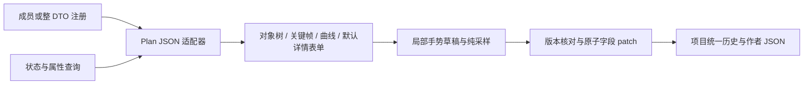
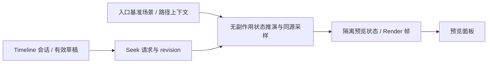

# 复杂参数定制与对象树时间轴

日期：2026-10-18。状态：design，UI 工具尚未实现；P6c 已完成命名与契约，见 [phase-6c.md](phase-6c.md)。归属 F-20261015-02 / P6 后续，扩展 [参数控件与场景目标设计](parameter-editor-design.md) 第 5–8 节；三层注册与状态查询的总体职责仍以该文为准。

## 1. 用户要求与本轮选择

用户要求复杂定制参考 Unity 类动画编辑交互：时间轴左侧树形结构以场景对象为父节点、对象支持的属性为子节点；可以选择属性加入动画控制，节点能够编辑值和切线，并展开为值曲线。此处按用户描述设计交互，不承诺复制 Unity 全部功能。

“作为轴重载”按属性加入当前动画的控制范围理解：未加入时不生成轨道；加入后由轨道控制该属性。它与运行时 Replace/Additive 混合方式分开。后者是轨道设置，不是第二套同属性覆盖轨道；当前运行时要求同一目标和属性在一个 Plan 内唯一。

用户随后将近期工具明确收敛为两个：先实现 Timeline 对象树时间轴，另一个是 animate 自定义曲线编辑器。Timeline 包括对象/属性轨道、关键帧、Hermite 曲线、事件、纯数值预览与项目历史；animate 自定义曲线单列后续切片。完整游戏场景预览、录制游戏对象操作、嵌套动画片段、音视频剪辑、多层动画混合不在首版范围。下文颜色、变换、粒子与 effect 参数只保留扩展接点，不作为本轮额外专业工具交付目标。

## 2. 已核对的代码事实

| 事实 | 设计影响 |
| --- | --- |
| P6a/P6b 已有 RegisterDto/RegisterMember/RegisterDefault、DtoEditorHost、SchemaForm、lease 与复杂值 JSON 回退 | 继续在三层映射上组合，不增加另一套编辑器注册体系 |
| AnimationPlanOptions.Plan 是 JsonElement，BatchId 是另一个字段 | 对 Plan 注册成员覆盖即可；BatchId 继续自动表单 |
| Core 的 AnimationPlanDefinition 已有 FrameRate、DurationFrames、Tracks、Events、LoopMode、Blocking、Skippable | 时间轴编辑现有计划，不另造编译时动画语言 |
| AnimationTrackDefinition 是 HandleId + Property + BlendMode + Keys | 对象父行由轨道分组投影产生，默认不增加运行时对象树 |
| Key.Frame 是整数，Value/InTangent/OutTangent 是 float，插值为 Step/Linear/CubicHermite，插值属于当前键之后的区间 | 编辑数据按帧保存；不能把任意加权 Bezier 或无限斜率直接塞进现有格式 |
| AnimationTrackSampler.Evaluate 是现有纯采样器 | 曲线显示和数值预览复用它，避免两套插值结果 |
| 完整校验要求首键在 0 帧、键严格递增、不得超过时长、同目标属性轨道唯一、浮点数有限、FPS 为 1..240 | 明确处理首键移动、碰撞、时长缩短和切线输入 |
| 内置 Plan 事件只接受图层显示/隐藏/移动/替换、effect 应用/停止、粒子启动/停止/burst 等限定类型 | 事件选择器使用明确能力清单，不能展示任意 catalog Entry |
| Plan 事件有同帧原数组顺序；运行时在采样前通知相应事件 | 事件排序与定位必须保留原序，同帧对象创建和动画采样要一致 |
| Editor 只有字段/DTO patch 提交与部分 Preview binding，没有通用拖动事务或作者场景查询 | 这两部分是待实现依赖，不能把现有接口改名当作完成 |

主要证据：[Plan/采样器](../../src/Shared/GalNet.Core/Scene/Timeline.cs)、[契约 DTO](../../src/Shared/GalNet.Contracts.Builtins/Entry/ComplexPrimitiveOptions.cs)、[完整校验](../../src/Shared/GalNet.Contracts.Builtins/BuiltinArgumentValidation.cs)、[事件调度](../../src/Shared/GalNet.Primitives.Builtins/AnimationPlanPrimitiveInstance.cs)、[当前表单协议](../../src/Presentation/GalNet.Avalonia.Controls/Forms/FieldBinding.cs)。这是静态代码核对，不是新增功能验证。

## 3. 界面与树形轨道

时间轴是独立 Timeline Dock，默认与资源/日志在底部同一区域，以同组标签页停靠，可拖动/浮动；通过视图菜单重新打开。Group 的 Plan 字段保留紧凑摘要和“编辑时间轴”入口，只激活该 Dock，不在每个 Entry 中嵌入完整画布。详情区继续复用 DTO 表单。

Timeline Dock 为项目会话内单实例，直接跟随当前选中的 Entry，不提供锁定/固定旧目标模式。目标用 Group 文档身份、Entry StableId 和字段 ID 定位，标题/面包屑显示 Group 与条目来源；切换普通 Entry 也必须切换面板状态，不能继续编辑上一个 Timeline。

| 当前选择 | 面板行为 |
| --- | --- |
| Timeline Entry | 绑定该条目并显示编辑器；未创建内容时显示明确的新建入口，不因选择自动写默认值 |
| 其他类型 Entry | 解除旧条目编辑绑定，显示“当前条目不支持时间轴编辑”，隐藏画布或显示禁用占位 |
| 没有选中 Entry | 显示“请选择时间轴条目”，编辑操作不可用 |
| Timeline 内容无效/契约暂不可用 | 仍定位当前条目，显示诊断和可用修复/JSON 入口，不伪造空时间轴覆盖原内容 |

多选时使用 Group 列表的活动项（SelectedEntry），不按类型从集合中筛选一个 Timeline，也不混合编辑多个条目。项目级选择上下文保存 Group/Entry 稳定身份，只在条目选择或活动 Group 改变时更新；点击 Timeline Dock 自身不会清除选中条目。跨 Group 选择、切类型、删除/取消选择和项目关闭均立即更新状态，过期异步结果不得重新绑定旧条目。

切换前先按统一草稿协议结束当前输入/取消未完成拖动，再释放旧字段租约。所有提交捕获原 Entry/字段/版本，不能在 await 后查询“当前选中项”作为提交目标。选择变化与不可编辑提示不产生作者历史，切回已提交条目恢复其作者内容。关闭 Group 页面不丢已提交内容；若它拥有当前选择则清除选择并进入无选择状态。Dock 从项目作者服务创建自己的 binding，不能借用随 Group 页面释放的参数 binding。关闭 Dock 释放绘图/订阅并协调草稿，项目历史依旧可用。

```text
播放/暂停  上一键 下一键  当前帧/秒  FPS  时长  吸附  [关键帧 | 曲线]
对象与属性树             当前值      时间刻度 / 播放头
▾ 左侧角色                           ◇        ◇        ← 汇总
  ▾ 位置                             （仅分组）
    ☑ X                   [120]      ◆────────◆        ← 属性轨道
    ☑ Y                    [40]      ◆────◆───◆
  ☑ 不透明度              [0.8]      ◆────────◆
▾ 背景
  ☑ 不透明度                         ◆────◆
▾ 事件                               ▣    ▣            ← 独立事件行
选中关键帧 / 轨道 / 事件的详情（默认表单 + 必要专属控件）
```

对象行展示友好名称、类型/缩略图、一定存在或可能存在；不显示 handle。同名对象加来源 Group/创建条目说明。位置/旋转等中间节点只是显示分组，只有运行时实际声明可动画的叶属性可加入轨道，不能凭 DTO 的所有数值字段推测动画能力。

添加对象后，从支持属性中搜索/勾选要加入的属性；可以切换“显示可添加属性”，默认树主要展示已加入的轨道。属性勾选代表已创作轨道，取消勾选是明确移除轨道的一条可撤销操作；单纯隐藏曲线、折叠或筛选不删除数据。编辑未加入属性的当前值也可以显式建立轨道，规则见下节。空父对象可保留为本地视图状态，保存不写入空运行时对象组。

一个属性只能有一条轨道。Replace/Additive 使用现有 BlendMode，界面显示“绝对值/叠加偏移”等可理解文案。没有运行时 mute/solo 字段，首版的曲线显示开关只影响视图，不能暗示关闭了游戏播放。

对象/分组父行的菱形是子轨道同帧键的汇总；点击可选择这些键。首版拖动在叶行完成，父行汇总只用于定位与选择，避免折叠时无意批量修改。左树和右侧时间区域共用行布局、纵向滚动及折叠状态；横向缩放/滚动只影响时间区域。

多对象选择和曲线可见性属于视图状态，不进内容历史。键盘操作遵守输入控件焦点：Space 仅在时间轴画布播放/暂停，文本和 NumericUpDown 保留自己的输入；Delete 删除所选键/事件，Ctrl+Z/Redo 路由到项目历史，不能单独维护时间轴历史。

## 4. 关键帧与值曲线

关键帧模式以菱形编辑帧位置，曲线模式以值对帧绘图；两者使用同一轨道和选择集合。曲线模式可以显示多条选中属性曲线，各有颜色、图例和可见开关；默认按属性单独缩放 Y，允许显式叠加并提示单位不同。鼠标悬浮/播放头显示当前帧及采样值。

选中键后详情显示帧、秒、值、出段插值、入/出切线。数字用 NumericUpDown，bool 用 CheckBox；枚举选择器支持搜索。画布拖动和数值输入相互同步，批量选择中不相同的字段显示混合值，修改后对选中集合原子应用。

### 4.1 叶节点当前值与自动写键

每个属性叶节点右侧常驻当前播放头的值编辑框；有轨道时显示采样值，并用实心/空心键标记区分当前位置已有键或仅为插值。未加入轨道时展示可确定的基准值，无法确定时显示空值提示而不是虚构 0。首版 Timeline 轨道仍为 float，因此这些叶节点使用 NumericUpDown。

用户确认输入或完成一次数值调节时，按捕获的属性与当前整数帧执行 upsert：该帧已有键，替换它的 Value，保留切线、插值和未知数据；该帧没有键，插入新键并保持帧序。仅刷新显示值/拖动播放头不写键。不同于之前“加键按钮选中已有键”的规则，值输入本身明确表达修改意图，不要求额外按录制或添加按钮。

新键默认继承包含该时间点区间的插值类别；Hermite 区间可用该点原曲线导数初始化入/出切线，随后替换为输入值，允许曲线随新值改变。不能用全局切线平滑顺手重写其他键。

若属性尚未加入轨道，首次输入一次性创建轨道、必要的 0 帧键及当前帧键：Replace 在基准值唯一时以它建立 0 帧；基准未知时以本次输入建立常值首帧，并明确提示采用了这个初值，作者可以回到 0 帧修改；Additive 首帧采用 0 偏移。当前帧为 0 时只建立一个键。所有动作合为一条项目历史，不留下无首键的半成品轨道。仅勾选加轨道但没有可用初值时，仍要求输入明确初值。

Additive 行的可编辑值是轨道的偏移量，并标注“偏移”；有唯一基值时可额外只读显示合成结果，不能把合成值直接存成偏移。进入值编辑时暂停播放并固定本次输入对应的帧；有效输入先提交到原帧再允许跳转，非法中间文本留在输入框且阻止目标/帧跳转，Escape 取消。一次按住 NumericUpDown 的连续调节/一次确认输入合为一个手势。

### 4.2 帧、时长和切线规则

规则：

- 添加轨道必须显式创建首键 0；Replace 在静态查询能给出唯一值时提供该值，否则要求输入，不假装“可能值”是真实当前值；Additive 首键可以明确采用 0 偏移。创建轨道和首键为一次历史。
- 在当前帧加键：已有键则选中它并编辑，不隐式覆盖/合并；新键默认取当前已验证曲线的采样值。无可采样数据时要求输入。
- 横向拖动吸附整数帧，可暂时关闭网格吸附，但提交仍取明确整数帧；垂直拖动改变值。Shift 约束方向，框选/Ctrl 多选，组合拖动保持键间相对帧差。
- 首键固定在 0 帧；选中首键的组合平移只允许改值或先取消首键选择。删除首键而轨道还存在时拒绝，删除整轨道可行。与已有键碰撞则本次提交拒绝并保留草稿，提供显式替换操作，不能静默丢键。
- 时长增长不自动添加末键；短轨道按现有 sampler 保持末值。缩短到已有键/事件之前时拒绝直接应用，提供明确的“裁剪内容并缩短”操作，整体一条历史。
- 修改 FPS 默认保留帧位置并改变秒数；另提供“保持秒数重新定时”，一次计算所有键/事件。整数舍入产生同帧键时报告冲突，不自动合并；同帧事件仍按既有相对顺序。

Hermite 的切线单位为“值/帧”。若横轴显示秒，绘图/输入换算使用“值/秒 = 值/帧 × FPS”，保存仍为值/帧。切线拖柄控制导数；只接受有限值。支持分离编辑入/出切线、一次性对齐斜率、设为线性斜率或平滑斜率。首版不宣称支持加权切线、任意 Bezier 权重、持续自动重算切线模式；“平滑”是明确执行的一次操作，不偷偷持久化不存在的模式字段。

切到 Step/Linear 时只改变插值选择，保留未使用的有限切线值，切回 Hermite 可恢复。末键的出段插值保留但无后段效果。对于 opacity/scale 等有限范围，检查 Hermite 区间内极值，不能只检查端点；禁止通过图表显示钳位来掩盖实际 sampler 越界。若完整业务校验尚无此规则，提取共享校验并统一编译/运行边界，不能仅在 Editor 私自改变语义。

## 5. 注册与复用默认表单

| 注册粒度 | 建议定制 | 保留的默认表单 |
| --- | --- | --- |
| AnimationPlanOptions.Plan 成员 | 对象树、关键帧/曲线/事件画布 | BatchId 及未覆盖根字段 |
| 变换 JSON 成员 | X/Y/旋转/缩放分组数值编辑 | 所在 DTO 的其他字段 |
| 颜色/向量等明确值类型 | 颜色选择、分量数值控件 | 外层布局、诊断、presence 操作 |
| ParticlePlay/Burst 的 Parameters 成员 | 发射/初始/运动/生命周期等模块表单 | 根部数量、Z 等字段 |
| EffectApply 的 Parameters 成员 | 根据选中程序 metadata 动态生成表单 | 程序选择、目标、顺序等根字段 |
| 特殊项目 DTO 整体 | 自定义画布 + context.CreateDefaultForm(排除已负责字段) | 未排除的字段 |

默认类型注册只用于语义一致的值类型，不给全部 string 注册目标选择器，也不给全部 JsonElement 注册时间轴。Timeline、Curve、Color 等行为控件和基础编辑模型放共享 Avalonia.Controls；Editor 的 Plan JSON 适配、项目历史和场景候选适配放 Editor，纯状态分析放 Editor.Shared。Core 保留运行时模型、采样/验证等中立事实，不引用 Control。

时间轴选中关键帧/轨道的详情用局部字段描述 + SchemaForm 生成；这些描述是专属适配器对现有契约的投影，不另注册执行 Entry，也不通过创建运行时对象获取属性。Sample 可直接组合同一曲线控件与自己的 binding；Editor 的 Locator/服务不成为共享控件必需依赖。

粒子 JSON 目前有自定义字段解析与默认/钳位行为，不能直接把 ParticleEmitterDefinition 的 CLR 属性名当作者 wire 名。需要显式对应 rate、initial 等现有键，保留未知模块；颜色、区间、渐变、生命周期曲线按独立控件复用。Effect 表单复用现有 shader metadata parser，数值/枚举/纹理/颜色按描述生成；程序变化只诊断不兼容的已有参数，不自动清理作者数据，缺少 metadata 时回退 JSON。专业 GPU/粒子实时预览继续后置。

## 6. 手势、草稿与 JSON 无损提交



手势采用 Begin/Update/Commit/Cancel 的概念协议，具体接口在实施时收敛。Begin 捕获 Entry/schema 生命周期、根字段原始 JSON 与集合版本；Update 只改变局部草稿并刷新纯采样；Commit 一次提交根字段 patch；Cancel 释放草稿，作者 JSON 和历史均不变。现有 IFieldPreviewBinding 不具备完整事务能力，不能把它直接当成这套协议。

拖动一百次鼠标移动只产生一次历史；无变化不增加历史。数值连续调节在一次按住/拖动或一次输入确认时合并，点击离散按钮各为一次。多键/多轨道/事件批量编辑、重新定时各为一次原子提交。多字段操作必须走宿主原子 patch，不逐字段写入后声称可撤销事务。

提交前核对原始根值与当前值，以及 Entry/type/collection 版本。其他页面修改、Undo/Redo、切类型、删除 Entry、切项目时取消手势并刷新，旧行绑定不会按旧数组索引写回。首版冲突整次拒绝，不做字段级自动合并；其他字段与作者未知参数仍保留。

轨道/键/事件的选择使用编辑会话内 RowId；不是数组下标，也不要求给现有运行时关键帧增加持久 ID。每次提交维护 RowId 到当前元素的映射，外部替换/无法可靠匹配时重建版本并取消旧选择/草稿。跨重开不保留关键帧选择，历史不持有画布或控件。

JSON 适配器保留原始树，只对已负责的键打 patch；移动数组元素时连同未知字段一起移动，修改值不重建整条 track/key/event。对象省略/null/default 原样保留。读取允许已知属性名的既有大小写，修改时使用原属性名；新属性使用约定 wire 名，歧义重复字段拒绝编辑并提示修复。不能通过 Deserialize<Plan> 后 Serialize<Plan> 覆盖作者数据。

语法正确但语义不完整的 Plan 可以保存为作者草稿；画布只对安全可解释的节点开放对应编辑，其余节点留诊断及原始 JSON。数值中间文本、正在拖动的非法帧位置不写作者内容。显式创建/修复才补必要数据，打开时间轴不补 defaults，不把旧无效轨道静默删掉。

关闭窗口/切换 JSON 模式/保存时先结束活动手势。无效输入留在当前编辑会话并显示错误，不因折叠卸载而丢失；关闭页面遵守统一草稿 Apply/Discard/Cancel 协调。自动保存只保存已提交作者内容，不隐式提交拖动中状态。此要求需要与 P7 关闭协调接通，不能沿用 P6b 折叠释放时直接丢弃复杂草稿的简化方式。

## 7. 对象、属性与时间轴事件

对象候选来自当前 Entry 执行前的抽象状态查询；Plan 内再叠加当前帧之前和同帧按原序发生的事件，并区分播放阶段。未来才创建的对象可在添加目标时搜索，但提示创建时间，播放头位置下尚不存在时不伪装一定存在。Loop/PingPong 等复杂事件生命周期在语义贡献器未完成时保守标记可能并提示分析不完整，不运行真实 Entry 来获取候选。

候选只分一定存在/可能存在；现有引用即使暂时无候选也不清空，缺目标按用户确认的“有则执行，没有忽略”处理。目标存在性与属性值唯一性是两回事；无法给出唯一初始数值时要求作者输入。

对象及播放身份由 Editor 自动分配，选择以 Locator 解析到底层 handle，正常作者 UI 不出现 HandleId/PlaybackHandleId 输入框。显示名称采用资源名、创建条目来源和可选友好标签，稳定身份不依赖名称/序号/路径。Plan 事件创建的对象沿用其已分配的不透明输出身份；事件重排不重新分配，引用不依赖事件数组下标。批量复制只按语义声明重映射内部引用，不能全 JSON 搜索替换相同字符串。

对象属性来源按领域贡献：Layer.AnimationProperties、ParticleEmitterInstance.AnimationProperties，以及 effect metadata/实际支持能力的交集。首版仅列出目前能由 float 轨道采样/执行的属性。颜色、向量、bool 不能因有数值输入控件就直接作为 float 轨道；需要现有分量能力或另立运行时契约扩展。未知自定义对象可以保留已有轨道，但缺少能力贡献时不臆造可添加属性。

事件行独立于数值轨道，支持添加、移动、多选、同帧明确前后排序，详情复用相应 DTO 表单及同一 Locator。选择器仅列当前支持的事件；未来项目扩展需同时提供契约允许、编译校验、状态转换与执行支持，不能只注册一个控件。事件参数同样支持不完整作者草稿。

内置事件能力清单目前散在私有 validator 与执行 switch。建议后续提取中立的能力描述供 Editor/校验复用，增加“声明事件都有执行/分析覆盖”的测试；运行时执行分派仍由对应模块负责，不把 UI 注册当执行授权。

## 8. 预览和验证分层

首版播放头和播放按钮只驱动局部时间与 AnimationTrackSampler，显示曲线采样和数值；拖动播放头不会执行 show/hide、修改变量、写存档、发通知或修改项目作者数据。事件只显示将发生的列表/标记；重播/循环不会真的重复触发副作用。静态对象缩略图不等同于真实游戏预览。

值合法性、目标属性类型、帧/键唯一性和编译规则继续来自统一契约。Editor 附加定位到对象/轨道/键/事件的诊断。部分无效内容可保存；完整编译严格失败。曲线控件可独立采样测试，最终接入场景预览另走游戏预览阶段。

## 9. 取舍与实施顺序

| 方案 | 选择与理由 |
| --- | --- |
| 所有复杂对象都套默认表单 | 基础可用，但不满足关键帧/切线编辑；保留为详情与回退 |
| 重写整个 AnimationPlan DTO 面板 | 需要协调多个根字段时可用；首版成员覆盖 Plan 更聚焦，其他字段继续复用 |
| 将 Plan 改强类型并 round-trip | 不是 UI 先决条件，会丢未知字段；首版保留 JsonElement + 专属无损适配 |
| 本次引入新的动画文件/Clip 资源格式 | 首版不引入；先将现有内嵌 Plan 编辑完整，复用 Clip 另行评估 |
| 把每次预览写进项目再取消恢复 | 首版采用局部草稿，避免脏状态、自动保存和项目 Undo 交错 |
| 自动附加运行时/长期持久子 ID | 首版不为键/轨道增加 ID；会话行身份 + 集合版本保护足够，未来引用关键帧本身再设计格式 |

建议按可验证依赖顺序推进：先完成 Locator/场景状态与属性能力基础，再交付 Plan 无损适配和手势/草稿协议，随后对象树与关键帧、Hermite 曲线和纯采样，最后时间轴事件的帧内查询与专业参数面板。曲线控件本身可先独立实现，作者可用的完整对象时间轴应在隐藏 handle 的选择器具备后交付。

验收至少覆盖：两同名对象、同对象多属性树和折叠同步；加/移轨道的单历史；0 帧保护/碰撞/时长与 FPS；Step/Linear/Hermite 采样及切线单位/极值；批量拖动 Cancel/Undo；旧版本异步提交；未知 JSON 往返与无打开写入；同帧事件顺序和事件创建对象；复制内部引用重映射；四语、缩放/滚动与真实画布键鼠；保存/关闭/重开。规模以可见区域绘制、按需计算与曲线降采样控制，阈值经实施实测再确定，不宣称已有性能数字。

本设计不修改业务代码、Core 契约或正式 spec，也不将上述建议标记为用户已逐项确认。当前没有阻塞设计的必答问题；正式 Phase 的退出条件和编号在下一步 phase plan 中细化。

## 10. 两个工具与 Timeline 命名收敛

用户确认近期只有两个专业工具，顺序为 Timeline 时间轴优先、animate 自定义曲线后续。它们共用曲线画布、关键帧选择/切线交互和手势协议，但数据含义不同：Timeline 编辑绝对帧与属性值；animate 编辑归一化时间到缓动进度的自定义函数，不能因为画布相同就共用同一份时间单位/值契约。

AnimationPlan 改为 Timeline 可行。当前静态搜索命中 23 个 C# 文件，包含 Core、契约、Primitives、展示接口/Avalonia 实现、状态恢复、Sample 和测试；这个数字不包含所有 JSON/文档，实施前仍需全仓核对。主要工作是统一符号、数据入口和消费者，并非重写采样算法。

P6c 已按以下对应关系完成命名统一；表左为设计基线旧名，表右为当前名称：

| 现名 | 目标名 |
| --- | --- |
| AnimationPlanDefinition / AnimationPlanOptions | TimelineDefinition / TimelineOptions |
| AnimationTrackDefinition / AnimationKeyframeDefinition | TimelineTrackDefinition / TimelineKeyframeDefinition |
| AnimationPlanEventDefinition / AnimationPlanPlayResult | TimelineEventDefinition / TimelinePlayResult |
| AnimationTrackSampler / AnimationPlanPrimitiveInstance | TimelineSampler / TimelinePrimitiveInstance |
| IAnimationPresenter.PlayAnimationPlanAsync | IAnimationPresenter.PlayTimelineAsync |
| BuiltinEntryIds.PlayAnimationPlan | BuiltinEntryIds.PlayTimeline |
| LoopAnimationState.Plan | LoopAnimationState.Timeline |
| animation.play、根参数 plan | timeline.play、根参数 timeline |

UI 和代码采用 Timeline 作为概念名称；IAnimationPresenter、AnimationBlendMode、AnimationLoopMode、动画播放身份/停止协议仍与 animate 共用，不为了消除所有 Animation 字样而改名。单属性 animate 继续使用原有单属性入口。

不保留旧符号别名或旧 Entry ID 回退。若采用表内 wire 命名变更，契约、编译、运行、事件/转场 composite writer、Sample 内容、fixtures、Raw 编辑/CLI 和恢复 payload 必须同一切片更新；核对受影响的状态 codec 版本，避免旧 payload 被当作新格式解释。这是可一起完成的内容变更，不是仅给窗口改标题。旧作者内容不做兼容迁移，但仓库中仍作为有效样例使用的内容必须同步更新。用户后续已授权实施，P6c 已验证这些命名与内容入口变更；Dock 和时间轴编辑工具仍留后续阶段。

animate 自定义曲线目前尚无可保存的自由曲线契约：AnimationOptions.Curve / AnimationRequest.CurveKind 保存的是内置枚举，IAnimationCurve 的运行期覆盖不参与 JSON。后续需要可序列化的归一化曲线定义、统一 sampler/validator、编译转换和循环动画恢复；只增加编辑 UI 会导致保存重开/循环恢复退回原曲线。首版建议保留内置预设并增加自定义模式，范围/端点/是否允许 overshoot 单独在该切片设计，不把 Timeline 的帧曲线直接塞进枚举字符串。

## 11. 实时预览架构备忘（不纳入阶段计划）

用户明确实时预览不作为阶段计划。本节仅保存上轮问题的架构分析，不安排实施步骤、不设退出条件，也不作为 Timeline 的前置依赖或验收范围；当前纯数值采样/曲线显示仍是时间轴编辑功能。

### 11.1 分离创作会话与预览场景

TimelineEditSession（概念名）因编辑本身需要目标身份、当前有效 timeline/手势草稿、播放头、revision 和诊断。若未来另行决定做预览，可订阅同一会话；现在不为预览新增必需服务。预览只消费快照，不能调用“修改叶节点值”的作者 upsert 接口，否则刷新画面会反过来写关键帧。预览失败不撤销已合法提交的作者内容。

未来增加独立 PreviewSession，拥有自己的 GameState/场景实例、展示 scope 和资源租约。与实际游戏运行、项目作者文档、玩家变量/存档/已读/成就/音频服务隔离；只能通过显式的作者编辑意图把用户操作写回 Timeline。它不是复用正在游戏中运行的唯一场景，也不能用静态“一定/可能”候选集伪造一条真实游戏状态。

### 11.2 基准场景与任意时间求值

每次预览捕获 Timeline 入口的不可变基准场景、变量值、资源版本及路径上下文。直线剧情可通过安全的状态贡献器构建；分支/条件不确定时让作者选择路径上下文或使用实际运行捕获的检查点，不能默认为两条分支的对象都在场。

对 Seek(t) 的结果应由“基准快照 + Timeline 草稿 + 时间 + 明确的预览上下文”决定。每次从干净基准/有效检查点重建需要的状态，按事件顺序推进到 t，再执行相应阶段的轨道采样；不能对已被上一次预览覆盖的场景继续累加 Additive，避免反复拖动数值漂移。纯采样仍复用 TimelineSampler；绘图用的归一化/单位换算不改变实际运行时求值。

时间轴事件不能在每次拖动中直接重新 Dispatch 普通游戏 Entry。为可预览事件提供无持久副作用的状态转换/展示适配，按同帧原序重建 show/hide/effect 等；不支持的事件展示清晰的预览不完整提示，仍保留原作者数据。Loop/PingPong 和事件重复按运行时约定建模；在契约未明确之前不能仅对时间取模来猜测事件状态。

### 11.3 可控时钟与渲染应用

当前 AvaloniaAnimationPresenter.PlayAnimationPlanAsync 使用 Stopwatch + 顺向循环，IAnimationPresenter 没有 Seek；StateRestoreSession 会启动恢复 continuation，也不是天然的编辑器 seek API。因此后续需要拆出可共享的时间映射/采样/混合求值，以及受控的预览帧应用能力。运行时继续用实时驱动，预览用 ManualClock/Seek 驱动，二者使用相同数学和属性执行规则，不要求为了首版编辑器马上改写整个 Engine。



渲染器/动画、粒子、shader、flipbook 必须使用一致的预览时间。场景渲染中已有自己的 Stopwatch，不能只控制动画播放头就声称全场景可回退。粒子采用固定 seed、固定步长，从有效检查点重模拟；视频拖动使用后端 seek 能力和异步帧，不能直接假定图层属性采样涵盖媒体位置。拖动默认静音，音频预听另开明确模式，存档/进度/成就等服务不接真实持久层。

Seek 和草稿改变可高频合并；每个任务带项目/schema/资源版本、草稿 revision、请求序号，取消旧任务并只发布最新结果。Undo/Redo、编辑入口之前的剧情、资源变化使基准或帧缓存失效；关闭预览/项目时释放解码、渲染和资源租约。性能优化采用局部属性更新、状态差量与检查点，不能以复用上一次污染的状态为代价。

## 12. 本轮明确的落地顺序

1. 统一 Timeline 命名方案与内容范围，形成可验证的全仓变更清单；命名不能只改 Editor。
2. 建立项目拥有的 Timeline 编辑会话、独立 BottomDocument Dock、无损字段适配和单历史手势；先有当前属性采样和叶值写键闭环。
3. 接入隐藏 handle 的对象/属性查询、树/帧/曲线画布和事件编辑。可先交付直线剧情与已有引用保留，分支与循环查询保守标记可能，不必等全量缓存优化才开始 Dock，但不能把不支持语义当作确定无影响。
4. 验证叶值改已有键/新建键/未加入属性建轨道、首键、切线保留、Additive 偏移、输入与播放头冲突、Dock 跟随当前活动 Entry、普通条目/无选择禁用、关闭、跨页撤销与保存重开、四语和真实模板键鼠。
5. Timeline 交付后推进 animate 自定义曲线契约与控件。实时预览不进入本阶段计划，不添加预览 Phase，也不作为上述功能的依赖或验收项。

本轮新增用户确认的是工具范围、Timeline 优先、独立 Dock/资源区域、叶值 upsert、跟随当前所选 Entry，以及实时预览不进入阶段计划；命名变更表、未知基值首帧策略与预览备忘仍是基于代码事实的设计建议。此文没有实施业务代码或声称具备实时预览能力。
