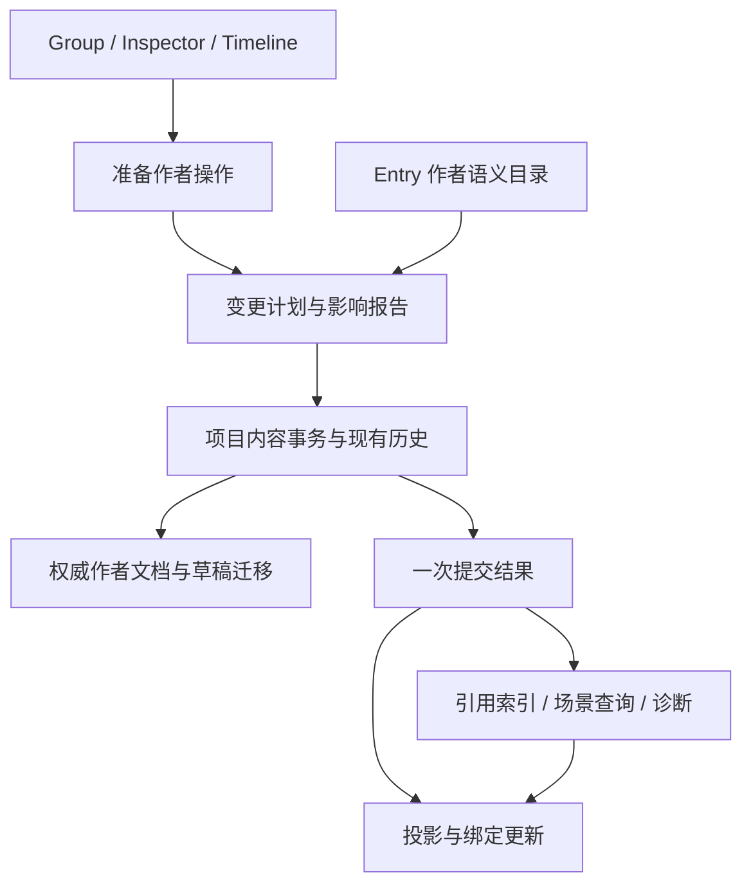

# Group 编辑一致性与模块化设计

日期：2026-10-26。状态：**用户已授权按阶段实施，GC1 verified，GC2–GC5 planned**。归属 F-20261015-02，问题依据见 [专项审核](review.md)，实际实施边界与证据见 [阶段计划](phase-plan.md) 和 [GC1 实施记录](phase-group-consistency.md)。本文保留整体目标与取舍；只有已验证的切片同步为 spec，不表示其余部分已经实现。

## 1. 要统一的边界

将一次作者修改统一为“准备操作 → 检查影响 → 提交 → 发布结果”。字段控件、删除按钮、剪贴板、Undo/Redo 都进入同一事务边界；引用索引、场景查询、Problems 和投影消费该边界发布的结果。

统一的是修改协议与语义事实，而不是把所有功能塞进一个服务。沿用现有项目作者文档、内容历史、保存基线、Schema/Forms 和纯场景分析，不另建文档副本、第二条历史或通用事件总线，也不要求 GUI 绕道 CLI。

当前代码的主要问题是：操作修改可观察投影，投影通知又写回作者文档；历史通知同时承担“按钮状态改变”和“内容已提交”；各消费者据此自行猜测失效范围。建议最终让作者文档成为操作的直接修改目标，投影只读并呈现结果。



## 2. 模块职责

下面是职责分区，不是每行强制新增一个程序集或接口。

| 模块 | 核心职责 | 不负责 |
| --- | --- | --- |
| 作者操作 | 将字段 patch、删除、移动、换类型、复制等变成可预检的计划 | 控件、弹窗、运行游戏 |
| 项目事务 | 串行校验和提交，协调现有历史、作者版本、草稿迁移，发布提交结果 | 按 Entry 类型推断对象语义 |
| Entry 作者语义目录 | 声明输出、引用、目标类别、身份迁移和场景影响 | 参数 schema 的重复定义、UI 事件订阅 |
| 项目派生事实 | 引用索引、场景数据流分析与依赖、结构化诊断 | 改写作者内容、强制保存门禁 |
| 草稿与绑定 | 草稿的归属和状态、视图租约、操作影响下的迁移 | 控制内容历史游标 |
| Editor 呈现 | 选择、展开、搜索、摘要、影响确认、导航和交互错误 | 修改另一份业务真源、自己扫描引用 |

部署在现有层级：Abstraction 仅放跨宿主的中立地址/变更/诊断契约；Shared 放作者操作计划、语义目录、纯索引和纯场景分析；Editor 放项目事务与现有历史的接入、控件绑定及展示。Shared 不反向引用 Editor 的 UndoRedoHistory。事务协议可以中立化，现有历史由 Editor 适配；不要为了复用一次性搬迁整个保存系统。

资源读取/效果声明准备仍由宿主负责，以不可变资源事实交给 Shared。共享 Avalonia Forms 只认识字段绑定和 lease，不认识 Group/Graph 历史。

## 3. 操作与提交协议

### 3.1 一个入口，两种执行成本

简单字段编辑仍可一轮调用完成，内部生成小计划并直接提交。删除、剪切、跨 Group 移动、换类型等操作才向 UI 暴露 Prepare 结果，必要时显示影响确认。不要让每次输入都等待全项目引用分析。

概念上的契约如下，名称和具体类型在实施时可按现有类归并：

```csharp
PreparedAuthorEdit Prepare(AuthorIntent intent, AuthorReadView source);
Task<CommitResult> CommitAsync(PreparedAuthorEdit plan, ImpactResolution resolution);

record PreparedAuthorEdit(
    EditPreconditions Preconditions,
    DocumentEdits Edits,
    DraftTransition Drafts,
    EditImpact Impact);

record AuthorChangeSet(
    long Revision,
    ChangeCause Cause,
    IReadOnlyList<GroupChange> Groups,
    GraphChange? Graph,
    IReadOnlyList<ResourceChange> Resources);
```

DocumentEdits 使用领域修改及其逆操作，不引入任意对象反射 patch 引擎。计划包含字段前值、成员身份、Group 顺序等实际读依赖；异步确认后必须重查。第一版可用项目 revision 做保守预检，后续按读集缩小，不能仅凭弹窗打开时的行号执行。

### 3.2 提交时序

1. Prepare 只读当前作者快照，生成变更及候选结果，不提交任何草稿或写盘。
2. UI 根据影响选择策略；无需要选择的影响直接继续。
3. 获取现有项目编辑串行门，重新检查计划依赖。过期时返回可重建的结果，不暗中覆盖或重新解释用户选择。
4. 应用作者修改、必要的草稿状态迁移和历史记录，作为同一个逻辑操作。必须参与一致性的部分失败时补偿；补偿再失败沿用 RepairRequired。
5. 成功后推进内容 revision，先标记相关派生事实失效并更新生命周期，再统一发布 AuthorChangeSet。
6. 投影、菜单、Problems 和各面板收到稳定结果后更新。不能让外部订阅者在集合逐项增删中看到半次提交。

History.Changed 继续用于 Undo/Redo 按钮和历史面板；内容消费者改用 AuthorChangeSet。IsBusy、MarkSaved、草稿输入、语言切换不冒充一次作者内容修改。

Undo/Redo 必须经相同的提交边界，成功后产生**新的单调版本**及实际方向的 ChangeSet。不能倒退 revision，也不能只把原事件再广播一遍。

投影/显示订阅者在提交完成后失败，应记录错误并重新同步该投影，不能回滚已经成功记入历史的作者修改。当前“ObservableCollection 通知失败即补偿作者内容”的测试和行为只能在权威文档与投影解耦后一起迁移，不能先把异常吞掉。核心修改与草稿迁移失败仍属于事务失败。

有文件发布的结构操作沿用已有 Working/Saved 双版本与失败恢复流程；本文不把文件 I/O 伪装成可内存回滚的事务。

## 4. 一份语义声明，多种消费者

### 4.1 Schema 管值，作者语义管关系

沿用 Core 的参数 schema/ValueCodec 做类型、缺省、约束验证。在 Editor.Shared 的作者语义目录中补足关系信息，例如：

| 类型 | 定义输出 | 使用引用 | 额外语义 |
| --- | --- | --- | --- |
| layer.show / showColor | 主图层输出，wire 槽位 handleId | 图片资源等属于独立资源域 | 创建/替换 Layer |
| layer.hide / move | 无 | 图层 handleId | 移除/修改目标 |
| animation.animate | 播放输出 playbackHandleId | 场景目标 handleId | 播放存在性及属性变化 |
| timeline.play | 根播放输出、事件中的输出 | 轨道、事件中的目标引用 | 委托 Timeline 子结构适配器 |
| 转场 | 输出 Layer、播放实例 | 输入 Layer | 委托现有纯编译终态分析 |

每个声明至少提供稳定的**逻辑输出角色**、实际 JSON 地址、引用域与允许目标类别。逻辑角色不能等同于参数名：handleId、newHandleId、toLayerHandleId 可能承载相容的主图层输出。兼容迁移由显式规则决定，不是“都是字符串就保留”。

从当前 SceneAuthoringIdentities、SceneFieldSemantics 与查询的重复清单开始收敛。复制重映射、自动创建身份、隐藏输出字段、目标筛选、引用索引与摘要都消费同一声明。场景转换算法作为可选的纯分析贡献器挂在同一目录下，继续复用 Core 能力和现有 Timeline/转场实现，不把复杂算法写成字段配置。

这里的“纯”是不得执行游戏 Entry 或产生 I/O/写回副作用。首版仅内置目录，不从项目 schema DLL 扫描和执行任意贡献器。未知自定义 Entry 标记覆盖不完整；后续需要扩展时再复用显式 Editor 扩展注册边界。原始 JSON 与未知字段始终保留。

### 4.2 引用索引与存在性分析必须分开

**引用索引**扫描所有作者文档，产出定义与使用记录：拥有者、JSON 路径、原始身份、引用域、允许种类和覆盖诊断。它回答“哪里写了这个引用”，包含未打开和不可达的 Group。

**场景分析**沿 Graph/Entry/Timeline 执行顺序，回答“这个位置能对应哪些创建者、一定还是可能存在、属性是否可知”。它沿用保守合并和预算，不执行游戏。

同一个 raw handle 可能被多个创建者重复定义或在不同分支替换。引用索引不能把 handle→唯一创建者当作事实；需保留候选定义，再由位置分析解析。普通资源 ID、变量 key 和场景身份分域，禁止对整个 JSON 做字符串替换。

**影响分析**把操作前后的场景结果与引用索引结合：删除创建者可能使引用失配；删除 hide/stop 则可能让对象重新出现；重排和拓扑变化会改变可达性。不能只分析“被删除条目自身输出了什么”。同批删除的消费者不作为外部断引警告，但该批对剩余剧情的状态影响仍需计算。

缺目标是作者警告，继续保留原引用并允许保存/编译；值契约、非法结构等仍按原规则报错。不完整分析独立携带原因，不能自动推导为“无影响”，也不默认阻止所有操作。

## 5. 身份与操作策略

需要分清三类身份：作者地址、场景运行身份、视图绑定代次。

- 作者地址沿用 `(GroupId, EntryStableId)`，Timeline 事件再加稳定事件身份。仓库允许不同 Group 使用相同 EntryStableId，不能假设全项目唯一。
- 场景运行身份沿用作者 JSON 中现有输出字符串；输出来源和逻辑角色用于编辑器解析与迁移。首版不修改 Raw/Compiled wire 格式，不把缓存 Locator 自动写进作者参数。
- 控件 lease 使用项目会话、作者地址、来源 incarnation/结构代次。删除/重建/不相容换类型产生新代次；Undo 恢复同一稳定 ID，也不复活旧控件。

推荐策略：

| 操作 | 身份与引用处理 |
| --- | --- |
| 同 Group 重排 | 保留作者及输出身份；重新分析受影响区间和后继 |
| 复制/副本 | 新作者身份、新输出身份，仅重映射复制批次内部引用 |
| 相容换类型 | 按逻辑输出角色显式迁移已有输出身份；新角色分配新身份 |
| 不相容换类型/删除 | 不自动改绑外部消费者；给出影响列表，允许保留未解析引用 |
| 项目内移动 | 保留输出身份；目标 Group 有 Entry ID 冲突时分配新作者 ID，并发布地址迁移表；失效旧 Locator/lease |
| Undo/Redo | 复用该操作确定的作者与输出身份，发布新来源代次与变更结果 |

### 剪切的推荐取舍

推荐先把“立即删除式剪切”改为会话内**待移动**：Ctrl+X 保留原条目并标识，成功粘贴时以一次事务移除源、插入目标，保留场景输出身份，并检查源版本及插入锚点。取消待移动不修改作者内容；来源后来改变、会话关闭或剪贴板被替换就撤销凭据。此方案避免两次操作之间的断引和两份同身份对象。

OS 剪贴板保留普通可复制数据；原对象所有权只由本项目会话凭据证明，不能信任外部 JSON 自称“剪切”。跨项目/已过期凭据按复制处理并给明确反馈。若必须保留 Ctrl+X 立即删除的现有体验，需要另设计历史持有的移动票据与消费状态，复杂度更高，不推荐作为首版。

这是一项待确认的用户交互变化，本文未将其写成已接受的规范。第一版至少保证所有路径复用引用影响提示，不能继续静默制造断引。

## 6. 用依赖与结果版本替代全局失效

保留全项目单调 revision 用于事务顺序，但不让它决定每个控件是否失效。派生服务按实际读依赖区分：

| 版本/代次 | 作用 |
| --- | --- |
| 内容 revision | 标识一次稳定作者提交、快照与诊断来源 |
| 目标来源/结构代次 | 判断字段、列表项、轨道/事件身份是否还是同一编辑对象 |
| 查询依赖版本 | Graph 入口摘要、Group 相关前缀、语义目录与所需资源事实 |
| 查询结果版本 | 目标/能力/数值/完整性等可观察事实发生变化时更新 |
| 展示变化 | 名称、语言和路径标签刷新，不撤销仍有效的编辑意图 |

服务以 ChangeSet 的 Group 范围和最早受影响位置失效前缀；重新求出口摘要，仅在出口事实改变时传播给后继。拓扑变化重建相关依赖，循环继续用有限固定点和预算；超预算保守降级并保留原因，不能提供假确定结果。

首版可先用粗粒度 Group 缓存，在相关结果相等时保留结果版本，再逐步加入前缀检查点。缓存保存有限数量的快照/检查点，不为每条 Entry 永久存一份场景，也不再在每次 IsCurrent 时序列化全项目。

版本相等只是优化，提交仍要验证当前写入位置、源值/结构、目标引用及实际读依赖。依赖变了但可证明结果等价时，服务可显式换发有效 lease；已明确失效的旧 lease 永不自行复活。避免“全局 revision 变了就丢草稿”和“结果一样就允许任意旧操作”两个极端。

后台资源准备绑定项目会话和实际作者/资源读集，旧资源代次结果不能覆盖新代。查询开始准备时保留同一逻辑请求，完成后换发快照；等待者取消只取消自己的等待。主线程按固定顺序发布结果，Changed 不再只代表资源变化。

## 7. 草稿是项目输入，控件只是借用者

草稿记录用显式 DraftKey 定位：作者地址、根字段、稳定子项身份/路径和来源版本；不要使用对象 RuntimeHelpers.GetHashCode 作为身份。没有稳定身份的数组项在结构变化时明确进入冲突，不能按旧下标偷偷提交。

草稿仓库只持有作者地址、基线值、输入、解析状态和解析/提交适配，不长期持有 Entry ViewModel。控件持有可释放 lease；关闭页面释放控件订阅，项目中仍有效的草稿继续保留。

推荐状态与保存规则：

| 状态 | 是否参与 Save All | 处理 |
| --- | --- | --- |
| 活动且有效 | 是 | 提交后进入现有内容历史 |
| 活动但无效/组合输入/冲突 | 是，需先处理 | Problems 提供定位和取消 |
| 因用户删除目标而归档 | 否 | 随删除操作保留，可查看、复制或明确丢弃 |
| 目标恢复后的待恢复输入 | 否，直到明确恢复 | 新绑定验证基线后恢复；旧绑定无提交权 |
| 干净且无视图/历史引用 | 否 | 可回收 |

默认删除语义建议为“删除条目，并把相关未提交输入随操作归档”，影响面板显示数量并提供取消。Undo 恢复作者内容后，若有归档输入，显示可恢复提示；恢复经新绑定验证，不让旧冲突草稿自动进入活动保存队列。历史淘汰前若仍有未解决的归档输入，转入有预算的项目输入回收区并提示，不能默默销毁用户输入。显式清空历史应单独说明其对这类恢复材料的影响。

这种归档/恢复策略同样是建议的交互决定，需要在实施前确定容量、提示及超预算策略。第一版可以保守保留现有冲突规则并在删除前明确协调输入；不能只为消除保存错误而直接删除所有草稿。

直接改同一字段导致的外部冲突继续保留，不能与“用户主动删除整个目标”混成同一种生命周期。普通输入的 Dirty 状态也不能触发场景内容版本改变。

## 8. 诊断、反馈与缓存所有权

Problems 消费结构化诊断，至少包含 code、severity、作者地址、JSON 路径、分析来源版本、相关创建者和可用操作。影响确认与 Problems 使用同一份分析事实，摘要/Picker 使用同一来源描述适配器，禁止再分别猜测 handle 的含义。

对象存在性仍只有一定/可能两类。引用失配、资源缺失、分析覆盖不完整、字段输入冲突和过期操作是不同诊断代码；不能把它们都显示成“未知错误”。历史结果过期后标注版本或替换，不给已删除的 Entry 计入活动错误数。

更新投影时维护 `(GroupId, EntryId)` 映射，并根据 ChangeSet 批量增删/局部刷新。搜索声明自己依赖 Type/Summary/Condition/显示序号，相关字段改变就重筛；与场景推断无关的展示更新不触发分析。

对象由明确拥有者保留：

- 活动投影拥有活动 Entry 的 ViewModel。
- 历史拥有可逆操作所需的中立数据和草稿归档句柄，并计入保留字节预算。
- 草稿仓库拥有活动/待恢复输入；分析缓存只拥有不可变事实。
- 页面拥有控件及订阅，不拥有作者文档；任何缓存都不永久持有已删除 ViewModel。

删除后活动投影释放对应对象，Undo 可从中立数据重建。历史淘汰释放其专属材料；项目关闭取消后台任务并释放全部仓库。不再使用 `_allEntries` 永久收集历次 ViewModel 作为销毁机制。

## 9. 方案取舍与迁移

不推荐继续在每个删除按钮、字段工厂和 Timeline 中增加各自的引用扫描与事件订阅：重复语义和通知顺序问题会持续增加。也不采用“每次修改都全项目重算”：正确性容易起步，但仍会误伤无关输入并放大 UI 成本。

暂不采用全量事件溯源/不可变文档重写；现有历史、文件发布和作者保存已经有大量约束与验证，解决本轮问题不需要整体替换。采用领域操作计划、提交结果和派生服务的组合，允许一次迁移一类操作。

推荐依赖顺序，具体 Phase 另行制定：

1. **事务与通知边界**：从 Entry 字段及批量增删重排切入，统一成功提交结果、版本及 Undo/Redo；建立文档→投影单向更新，保留失败补偿。新旧写入口不能对同一修改重复记历史/发内容事件。
2. **语义目录与引用诊断**：先迁移已有内置清单及 Timeline 子结构，接通只读引用索引、操作影响和 Problems；保持现有序列化/运行时语义。
3. **身份与草稿策略**：在用户确认交互取舍后接通待移动剪切、相容换类型和删除输入协调。每个纵向切片同时完成提交/Undo/Redo/Save/重开验证。
4. **查询依赖及 lease**：用 ChangeSet 驱动 Group/前缀缓存和结果发布，普通字段、Timeline 统一消费；验证后删除读时整项目 JSON 比较和多路历史订阅。
5. **呈现与释放**：迁移筛选/摘要/Problems 导航，移除永久 ViewModel 保留集合，加入长期编辑与预算验证。

Graph、项目文件和本地化操作可以逐步接入同一提交结果协议；已有专门原子性与保存基线规则由各模块继续拥有，不在首次 Group 切片中合并成巨型协调服务。跨域复合操作由项目事务组合中立子计划。

## 10. 必须验证的行为

- 删除创建者更新同 Group 后文和跨 Group 后继；删除 hide/stop 让后续候选恢复；Undo/Redo 都产生新的稳定提交结果。
- 不可达/条件/分支/循环/同名输出均保守处理；索引中“有字符串引用”不冒充“确定依赖该创建者”。
- 普通输出、播放实例、转场和 Timeline 轨道/事件使用相同声明；未知 JSON 无损，未支持语义有覆盖诊断。
- 复制只重映射批内引用；项目内移动保留输出身份；地址冲突、过期剪切、跨项目粘贴、取消和重复粘贴都有明确行为。
- 相容换类型不丢引用，不相容时提示影响；缺目标仍可保存/编译，运行时缺目标核验单列。
- 删除有输入的目标不会留下不可见的活动保存阻塞；恢复输入经过新 lease，Undo 不复活旧控件。
- 修改 Timeline 后文、无关 Group、名称或语言保留有效输入；修改实际前缀事实、根轨道/事件结构或相关资源使真正受影响的操作失效。
- 一次批量操作没有中间作者通知；失败补偿、通知失败、外部重载、项目关闭和资源迟到结果均不产生半份状态。
- 长期增删并淘汰历史后，已删除 ViewModel 和无主缓存可释放；归档输入和历史材料都计入实际预算。
- 最终通过真实挂载控件、多面板、保存重开、CLI 严格校验及当前源码构建；性能用实际大项目数据度量，不用静态推断虚报改善比例。

本文仅完成架构建议。待确认的产品取舍主要是待移动剪切与删除输入归档/恢复方式；这些取舍不影响先建立事务边界、语义目录和只读诊断的方向。
