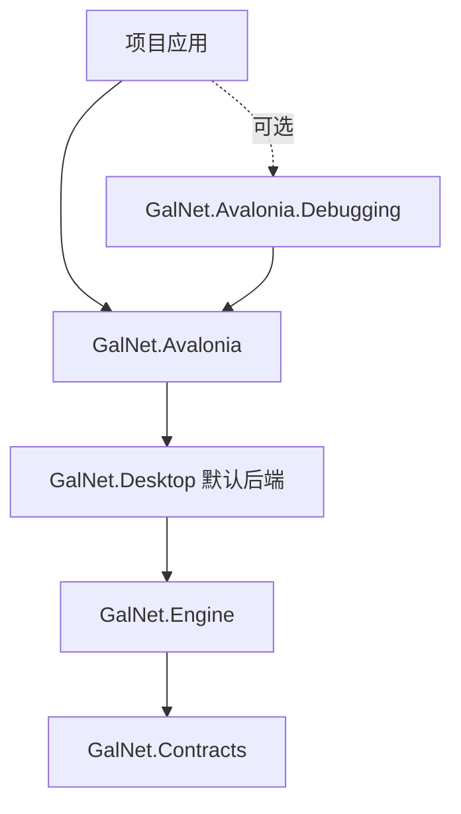

# 依赖图与可合并优化分析

2026-11-01，只读分析当前工作树，未修改工程引用、包版本或业务代码，未重新运行构建/测试。并行窗口/Branding 修改仅纳入依赖观察，不作为本 feature 成果。

## 结构与证据边界

扫描 src 中 33 个 csproj 的显式 ProjectReference：排除 ReferenceOutputAssembly=false 的构建/分析器边后，共 102 条潜在运行引用边，无循环。保留但不求值 Condition，所以这是各条件分支的并集，不是任一 RID/Player 配置的最终闭包。测试 props/targets 的包引用一并检查，避免把继承的 NUnit 等误判为未使用。

Core 没有工程引用，Runtime 仅引用 Core；Contracts.Builtins 的 SchemaGenerator 引用是构建期 analyzer，不是契约运行依赖。现有架构测试已对内置→Sample 和播放器循环做约束，不能重复宣称新增门禁。

公开包的主链如下（省略已显式存在的传递冗余边）：

来源为 packaging/packages.json、Pack-NuGet.ps1 及本机已有 0.1.0-dev.99 包的 nuspec/lib 目录。包是多程序集聚合，不能用源码项目的细粒度边界推断包消费者只获得哪些 DLL。

## 建议随本条 P3 处理的候选

1. **模板的完整构建依赖集合。** Sample 局部 Directory.Build.props/targets/Packages.props 仍导入仓库根配置与 packaging/GalNet.Player.props；Android/iOS 有本地 native targets。当前并行更改还新增 Desktop 的 src/Branding 图标路径。P3 必须同时检查 Import、资源/Content、native、版本及编译开关，不能只替换 ProjectReference。仓库外验证至少覆盖实际 Desktop 外壳；旧探针仅复制共享应用不足以证明新的图标/平台入口可直接交付。
2. **疑似无用 LibVLCSharp.Avalonia 引用。** 仅 GameView csproj 引用该包；当前源码/XAML没有 VideoView 或该包命名空间使用。视频路径使用 LibVLCSharp.Shared 的自定义像素回调与 Skia 场景合成。建议验证移除 UI 集成包，保留真实使用的 LibVLCSharp 和私有 VLC；搜索不能替代编译/原生视频验证。真实已生成 Avalonia nuspec 也声明了这条依赖，修正可改善外部消费者闭包。
3. **中央版本残留。** Markdown.Avalonia 仅有根 Directory.Packages.props 的 PackageVersion，src/test 与继承 props/targets 无 PackageReference 或代码/XAML使用。可删残留版本声明，收益为维护清晰度，不能声称因此减少运行包体积。
4. **源码与包消费者的依赖边界验证。** 复用现有 Test-NuGet.ps1，为本轮要移除的无用包和 Player/Developer 支持范围补充明确闭包断言；分别核对 managed DLL、native 资产、构建 props 和 analyzer。直接引用自己使用的 Core/Avalonia/DI 类型是合理显式依赖，不按传递可达性批量删引用。

以上是规划候选；实际移除需符合已定义的回归门禁，不在分析阶段修改锁图或版本。

## 值得优化但暂不并入的项

### Editor → GameView 的单点依赖

Editor csproj 为 GameView 注册 extern alias，源码唯一使用是 App.axaml.cs 调用 AvaloniaEffectRuntime.CreateDefaultCatalog()。该方法当前由空 DiscoverTextureFactories 创建 EffectCatalog，目录数据类型本来属于 Contracts.Builtins。

应让 Editor 组合目录数据，而非为了目录构造引用播放器运行实现；无需把整个 AvaloniaEffectRuntime 迁入 Rendering，因为它真实持有 GamePresentationState 和运行资源。可评估使用现有空目录构造或明确的目录定义归属，不为去掉一条边发明公共框架。

静态闭包比较显示删除该边只消除 GameView 工程本身，Editor 仍直接使用 Media.LibVlc、Rendering 和 Controls。不能宣称会移除全部媒体、Skia 或 Ursa。目前 Editor csproj/App 等有并行更改，且涉及 Editor 回归和相应锁图，建议另作小清理，避免快速 feature 交叉提交。

### 基础 Engine 包包含调试核心

packaging/packages.json 将 GalNet.Debugging 归入 GalNet.Engine；打包脚本逐程序集复制 lib；本机实际 galnet.engine/0.1.0-dev.99/lib/net10.0/GalNet.Debugging.dll 存在。GalNet.Player.targets 只控制编译开关和元数据，没有按 Player 移除该程序集。故可选 Avalonia.Debugging 包与源码条件引用，尚不能保证基础 Engine 包消费者不携带调试核心。

这里证据是程序集交付范围，不能推断消费者自动开启调试监听。若目标是玩家包完全不包含调试核心，需要单独调整包所有权、非 Avalonia 调试消费者及依赖契约，属于公开包边界变更，按快速通道规则另走普通 feature；本条不直接拆包。

### Avalonia → 默认 Desktop 后端的粗粒度闭包

源码 Controls/Rendering 可分别消费，公开 GalNet.Avalonia 包则固定依赖 GalNet.Desktop，聚合文件存储、LibVLC、miniaudio、SDL；现有 native miniaudio 包资产仅 win-x64。默认完整模板使用这些能力合理，自定义后端/移动宿主的 NuGet 消费需额外部署与排除规则。

不应将“工程名跨平台”当作所有 RID 原生包交付已完备。以后若有实际轻量渲染库或自选后端需求，再评估基础 Avalonia 与默认宿主/后端的包拆分、RID 资产和独立消费者矩阵；不把此类发行架构重做塞入本条 fast feature。

## 结论

pass-with-follow-up。源码依赖方向整体合理，主要可优化点在公开包聚合边界和模板构建附件。当前阶段不建议合并程序集、按传递引用批量删边、恢复主题协议或批量升级依赖。优先合并与模板 P3 直接相关的低风险候选；Editor 去 GameView 及调试/后端拆包单列。
